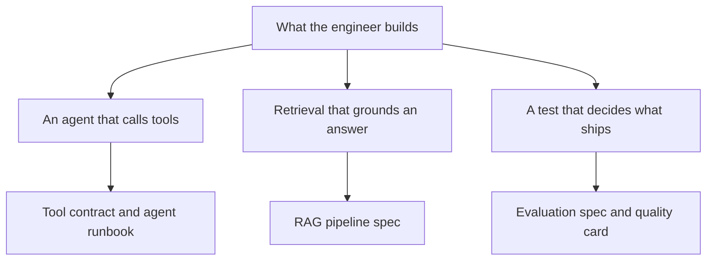

# AI engineers

This folder is for technical writers who document the systems AI engineers build.
It is separate from [Forward deployed engineers](../forward-deployed-engineers/README.md).
Use this folder when the work is the product: agents, retrieval, and the tests
that decide whether a change can ship. Use the other folder when the work is a
customer deployment and a leave-behind.

## How this was gathered

This page uses a convenience sample of 10 public AI engineer openings, read on
October 17, 2026. The notes below are the duties that overlapped across the
pool, the stack pieces that showed up with those duties, and the documents a
writer has to produce because of them. Employers, posting links, and posting
text stay out of this repository. The full method is in
[Persona sample method](../research/persona-method.md), and the coded counts are
in the [October 2026 round](../research/2026-10/README.md).

## What the role builds

Across the pool, the job is production software around a model. The overlapping
duties are:

- Build agents that call tools, keep context, and take more than one step.
- Build retrieval that grounds an answer in source material, including how
  content is split, embedded, searched, and cited.
- Build evaluations: a fixed set of questions, a grader, a regression check, and
  a written definition of a result that is good enough to ship.
- Keep the system reliable in production: retries, guardrails, logs, and a
  conscious trade among quality, latency, and cost.
- Write or maintain the documents those systems depend on. In this pool,
  documentation showed up as part of the engineering work, including
  documentation produced with AI coding tools.

Python was the language named most often. TypeScript showed up when the product
was a web application. Queues, vector databases, and a cloud host appeared as
supporting pieces. The pool does not share one stack.

The following diagram maps each kind of build to the page a writer clones:



## Growth of the role

The growth figures below describe the occupation. They do not describe the 10
openings in this pool, and they do not describe any one employer. The windows
are different, so they stay in separate rows.

| Measure | Figure | Window | Source |
|---|---|---|---|
| AI engineer jobs created, worldwide | 13 times as many | 2023 to 2025 | [LinkedIn, *Building a Future of Work That Works*, January 2026](https://economicgraph.linkedin.com/content/dam/me/economicgraph/en-us/PDF/linkedIn-labor-market-report-building-a-future-of-work-that-works-jan-2026.pdf), page 10 |
| Rank among the fastest-growing US titles | 1 | Jobs members started from January 1, 2023 through July 31, 2025 | [LinkedIn Jobs on the Rise 2026](https://www.linkedin.com/pulse/linkedin-jobs-rise-2026-25-fastest-growing-roles-us-linkedin-news-dlb1c). That page does not print a percentage. It lists LangChain, RAG, and PyTorch as common skills for the title. |
| US postings on Indeed titled "AI/ML engineer" | 334 percent higher | January and February 2020 to January and February 2025 | [Indeed Hiring Lab, July 30, 2025](https://www.hiringlab.org/2025/07/30/the-us-tech-hiring-freeze-continues/), in the table "Postings for some tech-titles have increased amid broader market decline" |

A 13-fold change and a 334 percent change answer different questions. Use the
row whose window matches the claim you are making.

## Documents writers need to know

Feature pages and API references still matter. The pool adds pages most product
doc sets do not have yet: proof a change is safe to ship, a contract for each
tool the agent can call, and a runbook for when the trace looks wrong.

The following table lists each document, why it showed up, and the template to
clone:

| Document | Why it showed up in the pool | Clone |
|---|---|---|
| Evaluation spec | Teams ship only when a fixed question set and a grader still pass. The spec is the product of the evaluation work. | [Evaluation spec](templates/eval-spec.md) |
| Tool contract | Agents are documented as callers of tools, including tools exposed through the Model Context Protocol (MCP). One chat-box page does not describe the system. | [Tool contract](templates/tool-contract.md) |
| RAG pipeline spec | Retrieval is a sequence of choices: what is ingested, how it is split, what search returns, and how a citation maps back to a source. | [RAG pipeline spec](templates/rag-pipeline.md) |
| Agent runbook | Production agents retry, stop for a person, and fail in ways an operator has to recognize. | [Agent runbook](templates/agent-runbook.md) |
| Quality, latency, and cost card | The same change can raise quality, slow the answer, or raise the bill. Someone has to record which trade is allowed. | [Quality, latency, and cost card](templates/quality-latency-cost.md) |

The following templates cover more documents this role produces. They were not
counted in the pool:

| Document | What it documents | Clone |
|---|---|---|
| Prompt and instruction spec | A system prompt or instructions as a versioned contract, with linked evaluations | [Prompt and instruction spec](templates/prompt-and-instruction-spec.md) |
| Model change note | A model switch or upgrade, with evaluation results for both models and the rollback | [Model change note](templates/model-change-note.md) |
| Guardrail spec | Each input or output check, what it blocks, and how a false positive is handled | [Guardrail spec](templates/guardrail-spec.md) |
| Dataset card | An evaluation or fine-tuning dataset: source, consent, splits, and known gaps | [Dataset card](templates/dataset-card.md) |
| AI incident review | A wrong, harmful, or costly result, reviewed with its trace | [AI incident review](templates/ai-incident-review.md) |

Copy a template into your docs site, replace every bracketed placeholder, and
delete the guidance comment before you publish. Writing rules are in
[Writing style for these templates](../templates/style.md).

## How the template set is changing

The pages this role needs are shifting from "how to call the model" to "how the
team knows this answer is allowed to ship." The repeated artifacts are
evaluation rubrics, tool schemas, and retrieval specs. When engineers produce
those pages with coding agents, the source a writer maintains has to be
something those tools can reuse: stable headings, one fact per section, and
placeholders that name the fact still missing.

If the same system is later installed for a customer, the leave-behind pages
live in [Forward deployed engineers](../forward-deployed-engineers/README.md).

## Clone this set

To copy this folder into `docs/`, run the following command:

```bash
npx degit zthewriter/context-for-ai/ai-engineers/templates#v1.0.0 docs
```

For other ways to copy a template, including one page at a time and with a coding
agent, see [Clone a template](../templates/how-to-use.md#clone-a-template).

To see the set filled in, read the [Kestrel example](templates/example-kestrel-docs-assistant.md), which documents
the Kestrel docs assistant.

## Further reading

- [Writing style for these templates](../templates/style.md)
- [RAG evaluation template](../templates/rag/12-evaluation.md), for reporting results to buyers
- [Model Context Protocol tools](https://modelcontextprotocol.io/docs/concepts/tools)
- [OWASP Top 10 for Large Language Model Applications](https://owasp.org/www-project-top-10-for-large-language-model-applications/)
