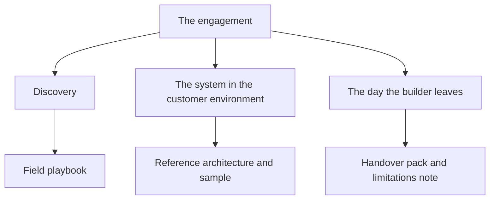

# Forward deployed engineers

This folder is for technical writers who document the systems forward deployed
engineers leave with a customer. It is separate from
[AI engineers](../ai-engineers/README.md). Use this folder when an engineer
embeds with a customer until a production system is in use, then sends the
pattern back to the product team. Use the other folder when the work is the
product itself: agents, retrieval, and the tests that decide a release.

## How this was gathered

This page uses a convenience sample of 10 public forward deployed engineer
openings, read on October 17, 2026. The notes below are the duties that
overlapped across the pool, the stack pieces that showed up with those duties,
and the documents a writer has to produce because of them. Employers, posting
links, and posting text stay out of this repository. The full method is in
[Persona sample method](../research/persona-method.md), and the coded counts are
in the [October 2026 round](../research/2026-10/README.md).

## What the role builds

In four openings, the code is the same agent and retrieval work an AI engineer
builds. The extra job is discovery, the customer's authentication and data, and a
handover. The overlapping duties are:

- Own the path from a vague request to a system the customer's team actually
  runs.
- Build the integration the product does not already do: APIs, data mappings,
  tools, and agents on the customer's systems.
- Write the leave-behind: playbooks, reference architectures, tutorials, sample
  applications, and the notes required to hand the system off.
- Explain the system to engineers and to the people who will operate it after
  the builder leaves.

One opening also named sending field feedback back to the product and research
teams. That is below the overlap rule, and the
[field feedback report](templates/field-feedback-report.md) covers it.

The stack follows the customer and the vendor platform. Python was named in six
openings and TypeScript in four, and four openings named no programming language.
Two openings named travel. One made documentation and whiteboarding a hiring
requirement, not a nice-to-have.

The following diagram maps each stage of an engagement to the page a writer
clones:



## Growth of the role

The growth figure below describes the occupation. It does not describe the 10
openings in this pool, and it does not describe any one employer.

| Measure | Figure | Window | Source |
|---|---|---|---|
| Forward deployed engineer jobs created, worldwide | 42 times as many | 2023 to 2025 | [LinkedIn, *Building a Future of Work That Works*, January 2026](https://economicgraph.linkedin.com/content/dam/me/economicgraph/en-us/PDF/linkedIn-labor-market-report-building-a-future-of-work-that-works-jan-2026.pdf), page 10. The chart groups forward deployed engineers and product managers in one title. |

A 42-fold change starts from a small base. The same report is the source for
the 13-fold growth of AI engineer jobs over that window. Those two figures are
paired in
[AI engineers](../ai-engineers/README.md#growth-of-the-role).

## Documents writers need to know

The product docs still matter. This role adds a second set: how this customer's
system was scoped, how someone else can copy the pattern, and how the customer
runs it after the builder leaves.

The following table lists each document, why it showed up, and the template to
clone:

| Document | Why it showed up in the pool | Clone |
|---|---|---|
| Field playbook | The same discovery and delivery steps repeat across accounts. Writing them down is how the next engagement starts further along. | [Field playbook](templates/field-playbook.md) |
| Reference architecture | Engagements produce a path other accounts should be able to copy: data in, a running system out, and the choices that are safe to change. | [Reference architecture](templates/reference-architecture.md) |
| Sample and tutorial | Demos, tutorials, and sample applications are part of the job, not a separate content program. | [Sample and tutorial](templates/sample-and-tutorial.md) |
| Handover pack | The build counts when the customer's team can run it, edit it, and turn it off. At least one opening names the handoff, with its documentation, as part of delivery. | [Handover pack](templates/handover-pack.md) |
| Limitations note | Operators who are not engineers have to know what the system will not do, in their language. | [Limitations note](templates/limitations-note.md) |

The following templates cover more documents this role produces. They were not
counted in the pool:

| Document | What it documents | Clone |
|---|---|---|
| Discovery brief | The customer's problem, systems, data, constraints, and decision makers, before the build | [Discovery brief](templates/discovery-brief.md) |
| Success criteria | The measurable result both sides agree marks the engagement done | [Success criteria](templates/success-criteria.md) |
| Integration spec | Each connection to a customer system: direction, authentication, data mapping, and failure handling | [Integration spec](templates/integration-spec.md) |
| Customer data map | Which customer data the system reads, writes, stores, and sends to third parties, and for how long | [Customer data map](templates/customer-data-map.md) |
| Deployment checklist | Go-live steps in the customer environment, with sign-off owners | [Deployment checklist](templates/deployment-checklist.md) |
| Field feedback report | What broke or was missing in the field, sent back to the product team | [Field feedback report](templates/field-feedback-report.md) |

When the deployment includes an agent or a retrieval pipeline, also clone the
matching pages from [AI engineers](../ai-engineers/README.md): the evaluation
spec, the tool contract, the retrieval spec, the runbook, and the quality card.
Those pages describe the product behavior. The pages in this folder describe
the customer engagement.

Copy a template into your docs site, replace every bracketed placeholder, and
delete the guidance comment before you publish. Writing rules are in
[Writing style for these templates](../templates/style.md).

## How the template set is changing

Forward deployed documentation is shifting from an implementation guide to a
leave-behind. The agent pattern still needs the pages in the AI engineer
folder. A second set then appears: the customer's authentication and data, the
success metric, and the playbook the next account should not have to
rediscover. Public tutorials are the same pattern written for people who are
not in the account.

## Clone this set

To copy this folder into `docs/`, run the following command:

```bash
npx degit zthewriter/context-for-ai/forward-deployed-engineers/templates#v1.0.0 docs
```

For other ways to copy a template, including one page at a time and with a coding
agent, see [Clone a template](../templates/how-to-use.md#clone-a-template).

To see the set filled in, read the [Kestrel example](templates/example-kestrel-engagement.md), which documents
an engagement with Kestrel.

## Further reading

- [Writing style for these templates](../templates/style.md)
- [AI engineer templates](../ai-engineers/README.md), for the agent, retrieval, and evaluation pages
- [Hybrid handoffs template](../templates/hybrid/04-handoffs.md)
- [Google developer documentation style guide](https://developers.google.com/style)
