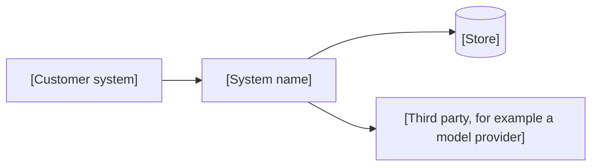

<!--
SECTION TEMPLATE: Customer data map (reference page)
Purpose: Record which customer data the system reads, writes, stores, and sends to
third parties, and for how long it keeps each kind.
Audience: The customer's security and privacy reviewers, the forward deployed team,
and whoever runs the system after handover.
Internal or external:
- Shared with the customer: the default. Their reviewers will check it.
- Internal only: add internal storage details and access lists.
Before you write, ask the builders:
- Which customer data does the system read, and from where?
- What does it store, where, and for how long?
- Which data is sent to a model provider or other third party?
- What is logged with each request?
Rules:
- Follow the writing style in ../../templates/style.md.
- Copy this page once per engagement, and update it when an integration changes.
- Give each data category its own row with a retention period. "Indefinitely" is a
  retention period, and the reviewer will ask about it.
- Never include real records in examples.
Agent notes:
- Infer from the code and configuration: data read, tables written, log fields,
  retention jobs, and third-party calls.
- Ask a person: the sensitivity of each category, the agreed retention, and the legal
  basis.
Delete this comment before you publish.
-->

# Customer data map: [customer] [engagement name]

This page lists the [customer] data [system name] reads, writes, stores, and sends to
third parties, and how long each kind is kept.

## Who this page is for

This page is for [customer]'s security and privacy reviewers and for whoever runs
[system name] after handover.

## Prerequisites

Read the [integration spec](integration-spec.md) for [engagement name], which names
each source.

## Data flow

The following diagram shows where [customer] data goes.



The flows in the diagram are:

- [System name] reads [data] from [customer system].
- [System name] stores [data] in [store].
- [System name] sends [data] to [third party] to [purpose].

## Data categories

The following table lists each category of data:

| Data | Read | Stored | Sent to third parties | Logged | Retention | Sensitivity |
|---|---|---|---|---|---|---|
| [Category] | [Yes or No] | [Where, or No] | [Who, or No] | [Yes or No] | [Period] | [Level] |

## Deletion

To delete [customer] data, [process]. Deletion completes within [period].

## Example

The following example shows a data category filled in for an engagement with Kestrel, a fictional hosting platform:

```markdown
| Data | Read | Stored | Sent to third parties | Logged | Retention | Sensitivity |
|---|---|---|---|---|---|---|
| Ticket text | Yes | Answer cache | Model provider, per request | Question only | 30 days | Customer confidential |
```
