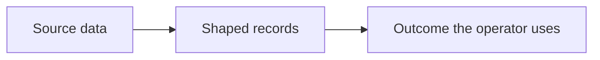

<!--
SECTION TEMPLATE: Reference architecture (concept page)
Purpose: Show one path from the customer's data to a running system that later accounts can copy.
Audience: The next engineer on an account, and the customer's technical lead.
Internal or external:
- External: safe to share with a customer's technical lead after you remove other customers' names.
- Internal: add the repository and the module names.
Before you write, ask the builders:
- What is the smallest path that has worked more than once?
- Which choices are safe to change per account, and which are not?
- What has to exist in the customer environment before this path works?
Rules:
- Follow the writing style in ../../templates/style.md.
- One path per page. A second path gets a second page.
- Say what the reader can change. An architecture that looks fixed will be copied wrongly.
Agent notes:
- Infer from the deployment repo: the components, their connections, and the
  environments.
- Ask a person: which parts the customer owns, which parts you own, and the
  constraints that shaped the design.
Delete this comment before you publish.
-->

# Reference architecture: [path name]

This page is one path from [starting data] to [running outcome] on [product or platform].
Copy it for a new account, then change only the rows marked safe to change.

## Who this page is for

This page is for the engineer on the next account and for the customer's
technical lead who has to recognize the path in their own environment.

## Prerequisites

Before you begin, make sure you have the following:

- [Access, network, or identity the customer must already have]
- The sample that pairs with this page, if you want to run the path rather than only read it

## The path

The following diagram is the whole path. Each box is a stage. The sample walks
the same stages with commands.

The stages are:

1. Read [source] as [identity].
2. Shape it into [form] using [component].
3. Serve [outcome] to [operator role].

## What you may change

The following table separates the choices that move per account from the
choices that define the path. Changing a fixed row means you are on a different
path and need a different page.

| Choice | Safe to change per account | Notes |
|---|---|---|
| [Choice, for example "Which system holds the source data"] | [Yes or No] | [What stays true if you change it] |
| [Choice] | [Yes or No] | [Note] |

## What this path does not do

This path does not do the following:

- [Out of scope behavior]
- [Out of scope behavior]

Those belong on [other page or "a separate architecture"].
