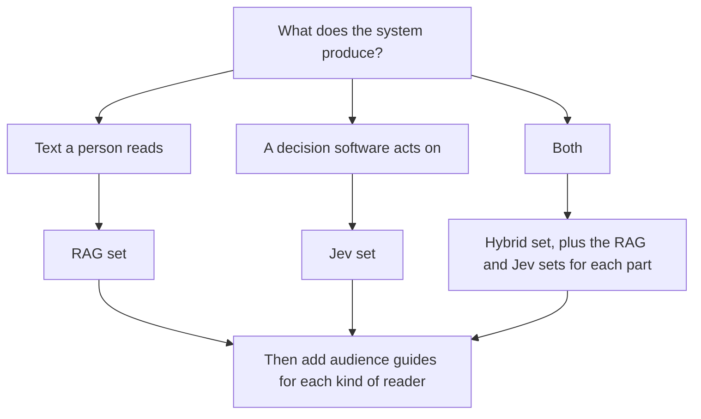

# Templates

These templates help technical writers, product managers, engineers, and anyone else
who documents an AI system write pages that people and AI agents can rely on. Copy a
template into your documentation site, replace the bracketed placeholders, and delete
the guidance comments.

Use the templates for internal documentation, such as an assistant or a router your
own teams depend on, or for external documentation, such as a feature your customers
use or an API developers call. Each template's guidance comment lists what to add or
remove for each.

## These are section templates

Each template is a template for one page, or one section, of a documentation site. A
set isn't one document to fill in from top to bottom. It's a menu of pages. Choose
the pages your readers need, and write each one from its template. Every set includes
a worked example for a fictional hosting platform, Kestrel, so you can see how the
templates read when they're filled in.

To plan a documentation set, start with [How to use these templates](how-to-use.md).

## Before you start

Read the following three pages before you fill in a template:

- [How to use these templates](how-to-use.md) shows you how to choose a set, choose
  pages, and write each page.

- [Documentation best practices for AI systems](best-practices.md) explains what the
  strongest AI documentation has in common, and why each template asks for what it
  does.
- [Writing style for these templates](style.md) summarizes the writing rules every
  template follows, based on the Google developer documentation style guide.

## Template sets

The following table lists each set, what it documents, and when to use it:

| Set | Documents | Use it when | Includes |
|---|---|---|---|
| [RAG](rag/) | A system that searches content and writes an answer | The system's output is text a person reads | Tutorial, quick start, concepts overview, concepts in depth, overview, manage content, how answers are generated, reference, security and data, limitations, troubleshooting, evaluation, change history, example |
| [Jev](jev/) | A system that uses a decision model to classify, score, and route | The system's output is a decision software acts on | Tutorial, quick start, concepts overview, concepts in depth, overview, state and inputs, questions and criteria, confidence and actions, reference, security and data, limitations, troubleshooting, evaluation, change history, example |
| [Hybrid](hybrid/) | How a decision model and a RAG system work together | One system does both. Use it alongside the RAG and Jev sets. | Tutorial, concepts, system overview, handoffs, failure modes, trace a result, security and data, evaluation, example |
| [Audience guides](audience-guides/) | How one kind of reader uses the system | The system has users, admins, or integrators who need instructions | End user, admin, and developer guides |
| [Technical design document](technical-design-doc.md) | How the system is built and why | Before building, for review, and kept current afterward | Architecture, content, thresholds, failure handling, evaluation, observability |
| [Case study](case-study.md) | What the system achieved for one team | After launch, once there are measured results | Situation, what was built, rollout, results with methods |
| [Diagrams](diagrams/) | The system as a picture, at each reader's level | Any page where a reader needs to see how the parts connect | Method, plus Mermaid diagrams at each audience level |
| [Content usage log](content-usage-log.csv) | Which pages answered which questions | After launch, to find gaps and pages to fix | A spreadsheet for tracing questions to the pages that answered them |

## Which set do I need?

The set you need depends on what the system produces. The following diagram shows
how to choose:

## Where the templates fit in a documentation workflow

Documentation for an AI system isn't written once at launch. Most of it changes
whenever the content, criteria, or thresholds change, not only when code ships. The
following table shows what to write at each stage:

| Stage | Write | Owner, usually | Update it when |
|---|---|---|---|
| Planning | Technical design document, overview draft | Engineering lead, with a writer | The design changes |
| Building | Manage content or state and inputs, questions and criteria, handoffs, reference, diagrams | Writer, interviewing the builders | A source, input, criterion, setting, or handoff changes |
| Before launch | Quickstart, limitations, confidence and actions, failure modes, security and data, audience guides | Writer, testing against the live system | The system's behavior changes, or support reports a new failure |
| At launch | Evaluation, final overview | Writer, with whoever ran the evaluation | Every evaluation run, with the new method and date |
| After launch | Troubleshooting, change history, content usage log | Operator or writer, on a fixed schedule | Every content refresh, criteria change, threshold change, or model version change |
| With results | Case study | Writer, with the team that used the system | Never edited after publishing. Write a new one. |

Two habits keep the documentation accurate:

1. **Treat a content change as a release.** A new source, a reworded criterion, or a
   changed threshold changes results as much as new code, so it gets a change history
   entry and a review of the pages it affects.
2. **Give every page an owner and a review date.** Pages about AI systems go out of
   date silently, because nothing reports an error when they do.

## How every template is built

Every template follows the same structure:

- **Guidance comment:** an HTML comment at the top states the page's purpose and
  audience, what to change for internal or external documentation, the questions to
  ask the builders, and the rules for filling it in. It doesn't render, so delete it
  before you publish.
- **Summary:** the first paragraph states what the page covers and who it's for.
- **Placeholders:** brackets mark what to replace, `[like this]`.
- **Lead-in sentences:** every list, table, procedure, and code sample is introduced
  by a sentence.
- **Accessible diagrams:** every diagram has a title, a text description, and an
  introductory sentence.
- **One page type:** each template is one concept, quickstart, task, reference, or
  troubleshooting page. If you need to answer two kinds of question, use two pages.

## Roadmap

This repository will grow into a library of writing for AI and people. The following
sets are planned, roughly in this order:

| Set | Covers |
|---|---|
| MCP server docs | Tools, instructions, authentication, and client setup for an MCP server |
| API docs | Reference, guides, errors, and machine-readable contracts that agents can use |
| SDK docs | Installation, quickstarts, reference, and migration guides |
| Headless product docs | Products used only through APIs, embeds, or agents, with no interface of their own |

To help build one, open a Discussion before you start writing, so the scope is agreed
first. For details, see [CONTRIBUTING.md](../CONTRIBUTING.md).
