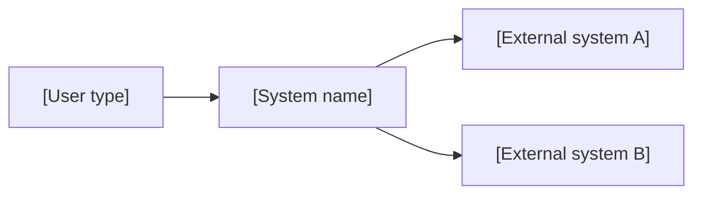
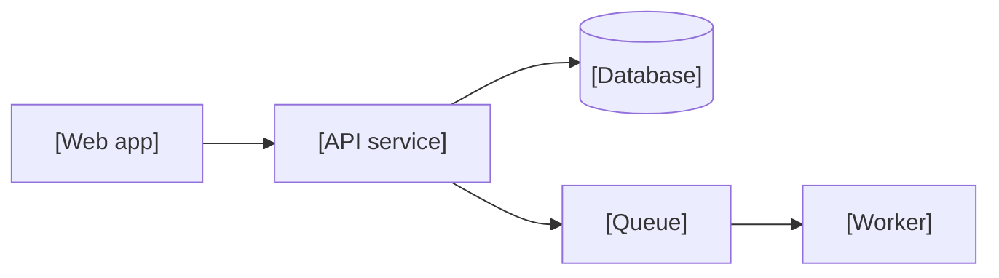

<!--
SECTION TEMPLATE: Architecture overview (concept page)
Purpose: Show the system's components and how they relate, at two levels: the system
in its context, and the containers inside it.
Audience: Engineers who build, review, or integrate with the system, and writers who
document it.
Internal or external:
- External: show the context level only, or a simplified container level without
  internal names.
- Internal: show both levels, with owners and repository links.
Before you write, ask the builders:
- Who and what talks to the system from outside?
- Which deployable units (services, databases, queues) make up the system?
- How does each unit talk to the others: protocol, sync or async, and direction?
Rules:
- Follow the writing style in ../style.md.
- Follow each diagram with one sentence per relationship. A diagram alone is not
  retrievable text.
- Keep five to seven boxes per diagram. Split a larger system into more diagrams.
Agent notes:
- Infer from the repo: services, databases, queues, and the calls between them, from
  deployment files and client code.
- Ask a person: external users and systems, ownership, and which names are public.
Delete this comment before you publish.
-->

# [System name] architecture

This page shows how [system name] fits into its environment and which components it
is made of. It uses two of the levels from the [C4 model](https://c4model.com/):
system context and containers.

## Who this page is for

This page is for engineers who build, review, or integrate with [system name].

## Prerequisites

Read the [technical overview](technical-overview.md) first, because this page uses
its names for each part.

## System context

The following diagram shows [system name] and the people and systems around it.



The relationships in the diagram are:

- [User type] uses [system name] to [goal].
- [System name] calls [external system A] to [purpose], over [protocol].
- [System name] calls [external system B] to [purpose], over [protocol].

## Containers

The following diagram shows the deployable units inside [system name].



The relationships in the diagram are:

- The [web app] calls the [API service] over [protocol].
- The [API service] reads and writes the [database].
- The [API service] publishes [job type] to the [queue], and the [worker] consumes
  them.

## Components

The following table lists each container:

| Container | Technology | Responsibility | Owner |
|---|---|---|---|
| [Name] | [Language, framework, or product] | [One sentence] | [Team] |

## Key decisions

The following list links each major architecture decision to its record:

- [Decision, in one sentence]: [link to the architecture decision record](adr.md)

## Example

The following example shows relationship sentences filled in for a fictional hosting
platform:

```markdown
- The Kestrel console calls the Kestrel API over HTTPS.
- The Kestrel API publishes build jobs to the build queue, and the build worker
  consumes them.
```
