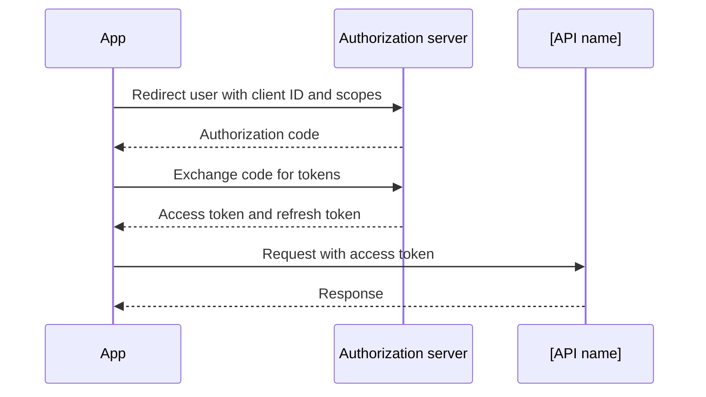

<!--
SECTION TEMPLATE: Authentication (reference page)
Purpose: Explain how a client proves who it is: the supported methods, scopes, token
lifetime, and an example flow.
Audience: Developers integrating with the API, and security reviewers.
Internal or external:
- External: document the methods customers use. Never include a real key.
- Internal: add service-to-service methods and where secrets are stored.
Before you write, ask the builders:
- Which authentication methods are supported, and which one is recommended?
- Which scopes exist, and what does each one allow?
- How long does each token live, and how is it refreshed or revoked?
Rules:
- Follow the writing style in ../style.md.
- Use obviously fake values in examples, such as `[API key]`.
- Give each method and each scope its own row or section, so each one can be
  retrieved alone.
Agent notes:
- Infer from the code: supported methods, header names, scope names, and token
  lifetimes.
- Ask a person: the recommended method, what each scope is meant to allow, and the
  revocation process.
Delete this comment before you publish.
-->

# Authenticate with the [API name]

Every request to the [API name] must prove which account it acts for. This page
describes the supported methods, the scopes, and how tokens are issued and refreshed.

## Who this page is for

This page is for developers who set up access to the [API name], and for security
reviewers.

## Prerequisites

You need [an account with the role that can create credentials, with a link].

## Supported methods

The following table lists the supported authentication methods:

| Method | Use it for | Header |
|---|---|---|
| [API key] | [Server-side scripts] | `Authorization: Bearer [API key]` |
| [OAuth 2.0 authorization code] | [Apps acting for a user] | `Authorization: Bearer [access token]` |

## Scopes

The following table lists each scope and what it allows:

| Scope | Allows |
|---|---|
| `[scope:read]` | [What it can read] |
| `[scope:write]` | [What it can change] |

## Token lifetime

[Access tokens] expire after [period]. [Refresh tokens] expire after [period]. To
revoke a token, [steps or link].

## Example flow

The following diagram shows the [OAuth 2.0 authorization code] flow.



The steps in the diagram are:

1. The app sends the user to the authorization server with its client ID and the
   scopes it needs.
2. The authorization server returns an authorization code to the app.
3. The app exchanges the code for an access token and a refresh token.
4. The app calls the [API name] with the access token.

## Example

The following example shows the token lifetime section filled in for a fictional
hosting platform:

```markdown
## Token lifetime

Kestrel access tokens expire after one hour. Refresh tokens expire after 30 days of
no use. To revoke a token, open the Kestrel console, select **Settings > Access**,
and select **Revoke**.
```
