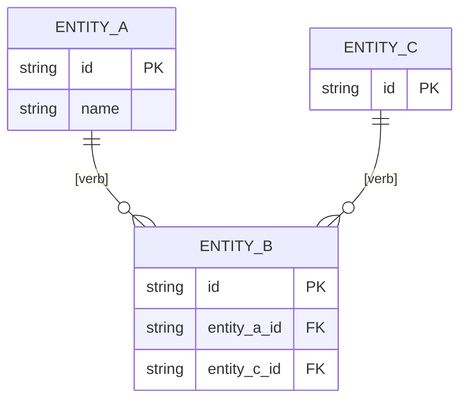

<!--
SECTION TEMPLATE: Data model and ERD (reference page)
Purpose: Describe the entities a system stores, their attributes, how they relate,
and which service writes each one.
Audience: Engineers who query or change the data, analysts, and agents that write
queries or migrations.
Internal or external:
- External: document only the entities exposed through the API, by their API names.
- Internal: document every table, with the owning service and the retention period.
Before you write, ask the builders:
- Which entities does the system store, and which service is the source of truth for
  each one?
- Which attributes hold personal or sensitive data?
- How long is each entity kept, and what deletes it?
Rules:
- Follow the writing style in ../style.md.
- Write one plain-language sentence per relationship after the diagram. A diagram
  alone is not retrievable text.
- Give each entity its own section and table, so each one can be retrieved alone.
Agent notes:
- Infer from the schema or migrations: entities, attributes, types, keys, and
  relationships. Infer the writing service from the code that inserts rows.
- Ask a person: the meaning of ambiguous fields, sensitivity, and retention.
Delete this comment before you publish.
-->

# [System name] data model

This page describes the entities [system name] stores, how they relate, and which
service writes each one.

## Who this page is for

This page is for engineers and analysts who query or change [system name]'s data.

## Prerequisites

To query the data, you need [access, for example "read access to the reporting
replica"].

## Entity relationship diagram

The following diagram shows the entities and their relationships.



The relationships in the diagram are:

- One [entity A] has zero or more [entity B] records. Each [entity B] belongs to
  exactly one [entity A].
- One [entity C] has zero or more [entity B] records.

## [Entity name]

[Entity name] represents [what it is, in one sentence]. [Service] writes it, and it
is kept for [retention period].

The following table lists the attributes of [entity name]:

| Attribute | Type | Required | Description | Sensitive | Written by |
|---|---|---|---|---|---|
| `id` | [Type] | Yes | Unique identifier | No | [Service] |
| `[attribute]` | [Type] | [Yes or No] | [Meaning] | [Yes or No] | [Service] |

## Example

The following example shows an entity section filled in for a fictional hosting
platform:

```markdown
## Deployment

A deployment represents one release of an app to one environment. The deploy service
writes it, and it is kept for 13 months.

| Attribute | Type | Required | Description | Sensitive | Written by |
|---|---|---|---|---|---|
| `id` | UUID | Yes | Unique identifier | No | Deploy service |
| `app_id` | UUID | Yes | The app this deployment belongs to | No | Deploy service |
| `image_tag` | Text | Yes | The container image that was released | No | Build service |
```
