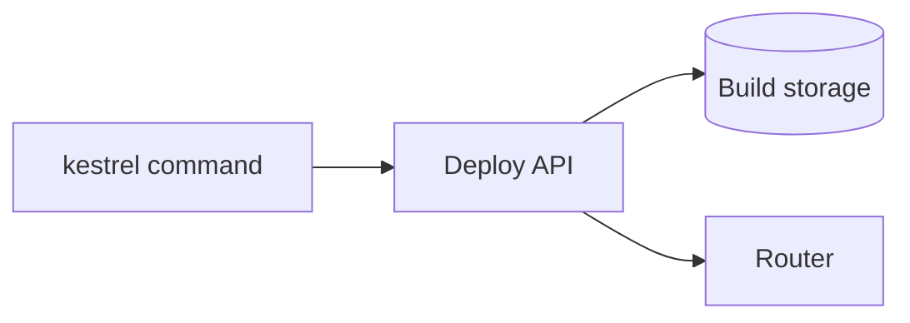
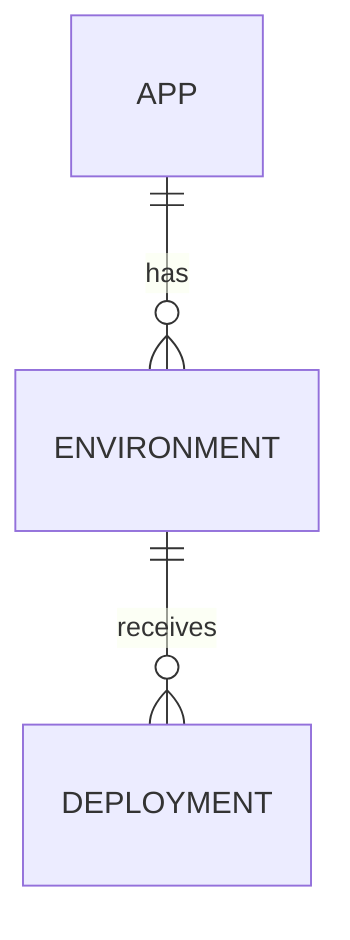

<!--
EXAMPLE: Classic set, filled in
This page fills in every classic template for one fictional project, the
Kestrel deploy CLI, so you can see how the pages read together. Kestrel is a
fictional hosting platform for web apps. The commands, versions, and output are
written to show the templates, not to document a real tool. Each section below is
one page of the documentation site, shortened to its key sections.
Delete this comment before you copy this page.
-->

# Kestrel deploy CLI documentation, filled in

This example shows the pages of the classic set filled in for the Kestrel deploy
CLI. Each section is one page, shortened to its key sections.

## Project README (CLS-01)

The following page is the repository README:

```markdown
# Kestrel deploy CLI

The Kestrel deploy CLI publishes a web app to Kestrel hosting from your terminal.

## Install

    npm install -g @kestrel/cli

## Quick start

    export KESTREL_API_KEY="[your API key]"
    kestrel deploy --env staging

## Where to find more

- Tutorial: docs/tutorial.md
- Troubleshooting: docs/troubleshooting.md
```

## Technical overview (CLS-02)

The following page explains what the CLI is and who uses it:

```markdown
# Kestrel deploy CLI overview

The Kestrel deploy CLI builds an app on your machine, uploads it to Kestrel, and
switches traffic to the new version. Developers use it from a terminal or a CI job.

## Main parts

- The `kestrel` command, which runs on your machine.
- The Kestrel deploy API, which receives the upload and starts the release.
```

## Architecture overview (CLS-03)

The following page shows how the parts connect:

````markdown
# Kestrel deploy CLI architecture

The CLI sends a build to the deploy API, which stores it and switches traffic.



The diagram shows three steps:

- The `kestrel` command uploads the build to the deploy API.
- The deploy API stores the build in build storage.
- The deploy API tells the router to send traffic to the new version.
````

## Data model (CLS-04)

The following page shows what the deploy API stores:

````markdown
# Kestrel deploy data model

## Entity relationship diagram



## Deployment

| Field | Type | Meaning |
|---|---|---|
| `id` | string | The deployment ID, such as `dep_7f3a` |
| `environment` | string | `staging` or `production` |
| `status` | string | `building`, `live`, `rolled_back`, or `failed` |
| `created_at` | timestamp | When the upload started, in UTC |
````

## API endpoint reference (CLS-06)

The following page documents the call the CLI makes on `kestrel deploy`:

```markdown
# Create a deployment

`POST /v1/apps/{app_id}/deployments` uploads a build and starts a release.

## When to use create a deployment

Use it from CI when you cannot install the CLI. The CLI calls this endpoint for you.

## Path parameters for create a deployment

| Name | Type | Required | Meaning |
|---|---|---|---|
| `app_id` | string | Yes | The app, such as `app_example` |

## Body parameters for create a deployment

| Name | Type | Required | Meaning |
|---|---|---|---|
| `environment` | string | Yes | `staging` or `production`. Missing returns `E1042` |

## Response example for create a deployment

    {"id": "dep_7f3a", "environment": "staging", "status": "building"}
```

## API errors (CLS-07)

The following page lists each error with its fix:

```markdown
# Kestrel deploy API errors

## Error response format

    {"error": {"code": "E1042", "message": "An environment is required."}}

## Retry guidance

Retry `E5xxx` errors after 5 seconds, up to 3 times. Never retry `E1xxx` errors,
because the request itself is wrong.

## `E1042`

- **Meaning:** the request did not name an environment.
- **Fix:** send `environment`, or run `kestrel deploy --env staging`. The CLI exits
  with code 2 for this error.
```

## SDK reference (CLS-10)

The following page documents one class of the JavaScript SDK:

```markdown
# Deployments

## When to use Deployments

Use `Deployments` to deploy from a Node.js script instead of the CLI.

## Create a Deployments client

    import { Deployments } from "kestrel-sdk";
    const deployments = new Deployments({ apiKey: process.env.KESTREL_API_KEY });

## Deployments.create

`create(appId, { environment })` returns the new deployment. It throws
`KestrelError` with `code: "E1042"` when `environment` is missing.
```

## CLI reference (CLS-11)

The following page documents one command:

```markdown
# kestrel deploy

## Synopsis

    kestrel deploy --env <environment> [--app <app_id>] [--wait]

## Flags for kestrel deploy

| Flag | Required | Meaning |
|---|---|---|
| `--env` | Yes | `staging` or `production` |
| `--app` | No | The app ID. Defaults to the app in `kestrel.json` |
| `--wait` | No | Wait until the deployment is live |

## Examples of kestrel deploy

    kestrel deploy --env staging --wait

## Exit codes for kestrel deploy

| Code | Meaning |
|---|---|
| 0 | The deployment started, or went live with `--wait` |
| 1 | The deploy API returned an error |
| 2 | `--env` is missing |
```

## Tutorial (CLS-12)

The following page takes a new user to a working result:

```markdown
# Deploy your first app to Kestrel

In this tutorial, you deploy a sample app to a Kestrel staging environment.

## Prerequisites

- Node.js 22 or later
- A Kestrel API key in the `KESTREL_API_KEY` environment variable

## Deploy the app

1. Install the CLI: `npm install -g @kestrel/cli`
2. In the app folder, run: `kestrel deploy --env staging`

## Check that it worked

The command prints the staging URL. Open it, and the sample app loads.
```

## Troubleshooting (CLS-15)

The following page pairs each symptom with its cause and fix:

```markdown
# Troubleshoot the Kestrel deploy CLI

## `kestrel deploy` exits with code 2

- **Cause:** the command was run without `--env`.
- **Fix:** add `--env staging` or `--env production`.
```

## Release notes (CLS-16)

The following page lists changes, breaking changes first:

```markdown
# Kestrel deploy CLI release notes

## 3.0.0

- **Breaking. `kestrel deploy` requires `--env`:** commands without it now exit with
  code 2. See the migration guide.
```

## Architecture decision record (CLS-18)

The following page records why `--env` became required:

```markdown
# ADR 7: Require an environment on every deploy

## Status

Accepted on 2026-08-04. Shipped in CLI 3.0.0.

## Context

In CLI 2.x, `kestrel deploy` without `--env` deployed to production. Support saw
staging builds reach production by accident.

## Decision

`kestrel deploy` requires `--env`, and the API returns `E1042` without one.

## Options considered

- Default to staging: rejected, because a silent default still surprises someone.
- Prompt for the environment: rejected, because CI jobs cannot answer a prompt.

## Consequences

Scripts without `--env` break on upgrade, so 3.0.0 is a major version with a
migration guide.
```

## Runbook (CLS-19)

The following page is for the deploy API's error alert:

```markdown
# Runbook: deploy API errors above 5 percent

## Last tested

2026-09-30, by the platform on-call engineer.

## What deploy API errors above 5 percent means

More than 5 percent of deploy requests returned an `E5xxx` error over 10 minutes.
Customers' deploys are failing.

## Confirm the problem

Open the deploy API dashboard and check the error rate panel. A spike in `E1042`
alone is customers' scripts, not an outage.

## Fix deploy API errors above 5 percent

1. If build storage reports errors, fail over to the standby bucket.
2. If the last deploy API release is under an hour old, roll it back.

## Verify recovery

The error rate stays under 1 percent for 15 minutes.

## Escalate

Page the storage team if failover does not lower the error rate.
```

## Onboarding guide (CLS-20)

The following page gets a new engineer to a first change:

```markdown
# Onboarding to the Kestrel deploy CLI

## Day 1: Get access

Ask your lead for the `kestrel-cli` repository and a staging API key.

## Day 2: Run the code locally

Run `npm ci` and `npm test`, then `npm link` to use your build as `kestrel`.

## Day 3: Read the architecture

Read the architecture overview and ADR 7.

## Day 4 and 5: Ship a first change

Pick an issue labeled `good first issue`, and deploy your branch to staging.

## Things that surprise new engineers

Without `--env`, every command exits with code 2. That is ADR 7, not a bug.
```
