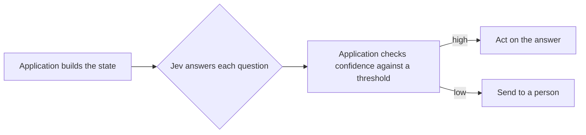

<!--
SECTION TEMPLATE: Decision model concepts overview (concept page)
Purpose: Define the decision model and the concepts behind it once, in plain language, so that every
other page in your documentation can link here. Model this page on the way REST API
and MCP documentation define the technology and link to the official reference before
going into details.
Audience: Anyone who is new to the decision model: developers, technical writers, reviewers, and
product managers.
Internal or external: Both. Replace the bracketed details in "How [product] applies
these concepts" with your own.
Before you write, ask the builders:
- What does [product] use the decision model to decide, and what does a person decide
  instead?
- Check the definitions and limits against the current official documentation at
  your model's official documentation, because model names and limits change.
- Fill in the final section from your real system.
Rules:
- Follow the writing style in ../style.md.
- Define each term the first time it appears, and use the same word every time.
- Don't copy numbers that might change. Link to the official page and say "at the time
  of writing" when you must quote one.
Agent notes:
- Infer from the code: which question types the system asks and how it uses
  confidence.
- Ask a person: what the system decides, what a person decides instead, and the terms
  the team uses with customers.
Delete this comment before you publish.
-->

# About [model name]

This page defines [model name] and the concepts you need to use, build, or document a system
that uses it. Read it before the other pages in this section.

## Who this page is for

This page is for developers who are adding automated decisions to an application,
and for writers and reviewers who need to explain how those decisions are made. It
assumes you can read a JSON request. It assumes no knowledge of machine learning.

## Prerequisites

You don't need any prior knowledge of decision models to read this page.

## What is [model name]?

[Model name] is a *decision model* from [provider, with a link to its documentation]. Examples include Jev from [TypeSafe AI](https://docs.typesafe.ai) and open source zero-shot classifiers such as [facebook/bart-large-mnli](https://huggingface.co/facebook/bart-large-mnli). Instead of
writing text, as a chatbot does, a decision model reads a piece of text and answers
typed questions about it. Each answer has a fixed shape, such as a probability, a
choice among options, or a score on a scale, so that code can act on it directly.

For the full API, supported models, and current limits, see the official
[model provider's documentation].

## Decision model compared with a text-generating model

The following table compares the two kinds of model:

| | Text-generating model | Decision model such as [model name] |
|---|---|---|
| Output | Free text | A typed answer: a probability, a choice, or a score |
| Used for | Writing, summarizing, and explaining | Classifying, routing, filtering, and checking |
| Your code | Parses or trusts the text | Reads fields and compares them with thresholds |
| Uncertainty | Often hidden in the wording | Returned as probabilities and a confidence value |

## How [model name] works

You send [model name] a *state*, which is the text to judge, and one or more *questions*
about it. [Model name] returns an answer for each question. Your code compares each answer's
confidence with a threshold, and then either acts on the answer or sends the decision
to a person.

The following diagram shows the flow:

## Core concepts

The following table summarizes each core concept and links to the full explanation:

| Concept | Definition | Learn more |
|---|---|---|
| State | The text that [model name] reads. It can be a string, a JSON object, or a list of strings. | [State](04-concepts-in-depth.md#state) |
| Question | One judgment that [model name] makes about the state. | [Questions and question types](04-concepts-in-depth.md#questions-and-question-types) |
| Question type | The shape of the answer: yes or no, one option from a set, or a level on an ordered scale. | [Questions and question types](04-concepts-in-depth.md#questions-and-question-types) |
| Criteria | The written definitions that [model name] judges against. | [Criteria](04-concepts-in-depth.md#criteria) |
| Probability | How likely [model name] considers an answer. | [Probability and confidence](04-concepts-in-depth.md#probability-and-confidence) |
| Confidence | How certain [model name] is about the whole answer. | [Probability and confidence](04-concepts-in-depth.md#probability-and-confidence) |
| Threshold | The confidence an answer needs before your code acts on it. | [Thresholds](04-concepts-in-depth.md#thresholds) |
| Model version | The specific [model name] release that your requests use. | [Model versions](04-concepts-in-depth.md#model-versions) |

## Vocabulary

Use the following terms consistently in your documentation:

| Term | Meaning | Don't use |
|---|---|---|
| State | The text [model name] reads. | Prompt, input text, context (unless you define the difference) |
| Question | One typed judgment about the state. | Prompt |
| Criteria | Written definitions of the options or levels. | Rules, labels |
| Answer | [Model name]'s response to one question. | Output, completion |
| Decision | The action your system takes, based on one or more answers. | Answer (an answer is [model name]'s; a decision is your system's) |

## How [product] applies these concepts

The following table shows how [product] uses [model name]. Document your own choices, and link
to the pages that explain each:

| Concept | What [product] does | Where it's documented |
|---|---|---|
| State | [For example "The subject and messages of a request, with personal data removed"] | [State and inputs](06-state-and-inputs.md) |
| Questions | [For example "Three: area, urgency, and security"] | [Questions and criteria](07-questions-and-criteria.md) |
| Thresholds | [For example "Act at confidence 0.80 or higher"] | [Confidence and actions](08-confidence-and-actions.md) |
| Model version | [For example "Pinned to a specific version"] | [Reference](09-reference.md) |

## Next steps

To continue, use one of the following pages:

- To go deeper on each concept, see [Concepts in depth](04-concepts-in-depth.md).
- To make your first call, see the [quick start](02-quickstart.md).
- To build a complete decision step, see the [tutorial](01-tutorial.md).
