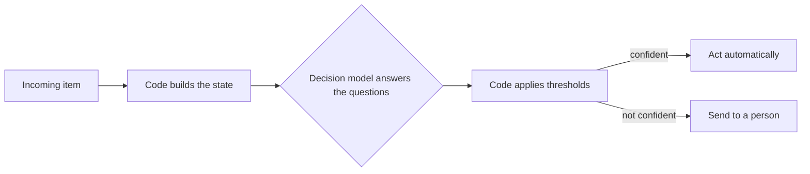

<!--
SECTION TEMPLATE: Overview (concept page)
Purpose: Explain what the system decides, who is affected, how it works, and where a
person is involved. This is the page most readers see first.
Audience: Everyone, including the people affected by the decisions.
Internal or external:
- External: describe decisions in terms of what happens to the reader, and how to
  get a decision reviewed.
- Internal: add an "Owners and support" section with the owning team, on-call
  channel, and links to runbooks and dashboards.
Before you write, ask the builders:
- In one sentence, what does it decide, and what happens as a result?
- Which rules are ordinary code, and which judgments does the model make?
- Which decisions are fully automatic, and which go to a person?
- Who is affected, and how can they get a decision reviewed?
Rules:
- Follow the writing style in ../style.md.
- Keep the summary to two sentences.
- Say plainly that the system decides and doesn't write, if that's true.
Agent notes:
- Infer from the repo: the inputs, the questions asked, and the actions taken on each
  result.
- Ask a person: who is affected by the decisions, who reviews them, and who owns the
  system.
Delete this comment before you publish.
-->

# About [system name]

[System name] decides [what, for example "which team handles each support ticket and
how urgent it is"]. It reads [content, for example "the ticket's subject and
messages"], answers a fixed set of questions about it, and [what happens next, for
example "routes the ticket"]. It doesn't write text.

## Who this page is for

This page is for anyone who uses, reviews, or is affected by [system name]'s
decisions, including [audiences, for example "support agents, team leads, and the
developers who maintain it"]. It assumes no knowledge of machine learning.

## What is [model name]?

[System name] uses [model name], a *decision model* from
[provider, with a link to its documentation]. A decision model reads text and answers typed
questions about it, instead of writing text. For a definition of each concept, see
[About [model name]](03-concepts-overview.md).

## Prerequisites

Before you use [system name], make sure you have the following:

- [Access, for example "The Support Lead role"]
- [What to read first, for example "The quick start"]
- [Anything else the reader needs]

## What [system name] decides

The following table lists each decision, its possible outcomes, and what happens
next:

| Decision | Possible outcomes | What happens next |
|---|---|---|
| [Ticket area] | [Billing, technical, account, other] | [The ticket goes to that team's queue.] |
| [Urgency] | [A place on a scale from routine to urgent] | [Sets the response target.] |
| [Decision] | [Outcomes] | [Action] |

## Why [system name] uses a decision model

[System name] uses [model name], a decision model. A decision model is different from a
chatbot or a text-generating model: instead of writing a response, it answers typed
questions about the content it's given. Each answer is one of the following:

- **Yes or no:** the probability that the answer is yes.
- **One option from a set:** one option from a set, with a probability for every option.
- **A level on a scale:** a place on an ordered scale, with a probability for every level.

Because every answer is a probability, [system name] can act automatically when the
model is confident and send the decision to a person when it isn't.

## How it works

The following diagram shows how [system name] makes a decision:

[System name] makes each decision in the following steps:

1. **Build the state:** Code gathers the content the decision needs, such as
   [fields]. For details, see [State and inputs](06-state-and-inputs.md).
2. **Ask the questions:** The model answers each question about the state using
   written criteria. For the exact questions, see
   [Questions and criteria](07-questions-and-criteria.md).
3. **Apply thresholds:** Code compares each answer's confidence with a threshold and
   chooses an action. For the thresholds, see
   [Confidence and actions](08-confidence-and-actions.md).

## What code decides and what the model decides

The model makes judgments that need reading. Fixed rules stay in code. The following
table shows which is which:

| Decided by code | Decided by the model |
|---|---|
| [For example, "Tickets from accounts on the Enterprise plan always go to the priority queue."] | [For example, "Which team the ticket is about."] |
| [Rule] | [Judgment] |

## When a person is involved

[Describe which decisions always go to a person, and which go to a person only when
the model isn't confident enough.]

## If you think a decision was wrong

To request a review of a decision, [method]. [State how fast reviews happen.]

## Key terms

The following terms appear throughout this documentation:

| Term | Meaning |
|---|---|
| State | The content a decision reads. Nothing outside the state affects the decision. |
| Question | One judgment the model makes about the state, such as "Which team should handle this?" |
| Criteria | The written definitions of each option that the model judges against. |
| Probability | How likely the model considers each option. |
| Confidence | How certain the model is overall, from 0 to 1. A high probability for one option doesn't always mean high confidence. |
| Threshold | The confidence an answer needs before [system name] acts on it automatically. |

## Next steps

To continue, see the following pages:

- To send or view your first decision, see [Get started with [system name]](02-quickstart.md).
- To see exactly what the model is asked, see
  [Questions and criteria](07-questions-and-criteria.md).
- To learn what it can't decide, see [Limitations](11-limitations.md).
