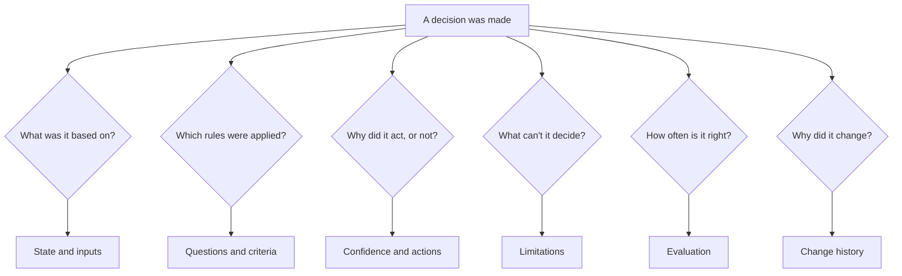

# Decision model section templates

These are *section templates*. Each one is a template for one page (or one section
of your documentation site) about a system that uses a decision model. They aren't a single
document to fill in from top to bottom. Pick the pages your readers need, copy each
into your documentation site, replace the bracketed placeholders, and delete the
guidance comments.

The templates work for internal documentation, such as a request router your support
team relies on, and for external documentation, such as a moderation or approval
feature your customers are affected by. Each template's guidance comment says what to
add or remove for each.

## Who these templates are for

These templates are for technical writers, developers, product managers, and reviewers
who document a system that makes automated decisions with a decision model. You don't need to know
machine learning to start. The [concepts overview](03-concepts-overview.md) defines
every term.

## What is a decision model?

A *decision model* reads text and answers typed questions about it instead of writing
text: a yes-or-no probability, one option from a set, or a place on an ordered scale.
Each answer carries probabilities, and some models add a confidence value. Software
then acts on the answers. Examples include Jev from
[TypeSafe AI](https://docs.typesafe.ai) and open source zero-shot classifiers such as
[facebook/bart-large-mnli](https://huggingface.co/facebook/bart-large-mnli).

For the API, current models, and limits, see your model provider's official
documentation. Every decision-model documentation set
should define the core concepts: state, questions, question types, criteria,
probability, confidence, thresholds, and model versions. The
[concepts overview](03-concepts-overview.md) and
[concepts in depth](04-concepts-in-depth.md) templates give you pages to adapt.

## Before you start

Before you use these templates, make sure you have the following:

- Access to the people who built the system, or to its configuration
- A working copy of the system that you can send real items to
- A read of [How to use these templates](../how-to-use.md)
- A read of [Writing style for these templates](../style.md)

## Why a decision system needs its own documentation

A RAG system produces text that a person reads, so its documentation explains where
the words came from. A decision-model system produces a decision that software acts on, often
with no person involved: a ticket is routed, a message is blocked, or a passage is
dropped. The people affected need to know what is decided, from what information, by
which criteria, how sure the system must be before it acts, and what happens when it
isn't sure.

For how a decision model uses content, read
[How decision models use context](../../write-for-ai/04-how-decision-models-use-context.md).

## The templates

Each template is one page type: a concept, a quickstart, a reference, or a
troubleshooting page. The following table lists the templates, the question each one
answers, who reads it, and when to write and update it:

| Template | Page type | Answers | Primary audience | Write it | Update it when |
|---|---|---|---|---|---|
| [Tutorial](01-tutorial.md) | Tutorial | How do I add a working decision to an application, step by step? | Developers | When the decision works end to end | A step, a dependency, or the output changes |
| [Quick start](02-quickstart.md) | Tutorial | How do I send my first request and read the answer? | New users, developers | Once a first request works | The steps or the output change |
| [Concepts overview](03-concepts-overview.md) | Concept | What is the model, and what do these terms mean? | Everyone | Once, at the start | Your terms or defaults change |
| [Concepts in depth](04-concepts-in-depth.md) | Concept | What are the options for each concept, and how do I choose? | Developers, writers | After the design is settled | Your choices change |
| [Overview](05-overview.md) | Concept | What does it decide, for whom, and how? | Everyone | Draft in planning, finish at launch | The decisions or the people affected change |
| [State and inputs](06-state-and-inputs.md) | Concept and reference | What content does each decision read? | Developers, operators, privacy reviewers | While the inputs are designed | A field is added, removed, or redacted |
| [Questions and criteria](07-questions-and-criteria.md) | Reference | Exactly what is asked, and how is each option defined? | Operators, reviewers, writers | While the criteria are drafted | Any wording changes, because wording is behavior |
| [Confidence and actions](08-confidence-and-actions.md) | Concept and policy | How sure must it be, and what happens at each level? | Operators, support, affected people | Before launch | A threshold or an automatic action changes |
| [Reference](09-reference.md) | Reference | What are the exact fields, answer types, errors, and limits? | Developers | With the first integration | Any field, type, or limit changes |
| [Security and data](10-security-and-data.md) | Concept | What data is used and stored, and how is manipulation limited? | Admins, security and privacy reviewers | Before a security review | Inputs, storage, or retention change |
| [Limitations](11-limitations.md) | Concept | What can't it decide reliably, and what happens instead? | Everyone | Before launch, tested on real cases | A new failure is found, or a limit is fixed |
| [Troubleshooting](12-troubleshooting.md) | Troubleshooting | Why was this decision wrong, and how do I fix it? | Operators, developers, support | After the first reversed decisions | A new common problem appears |
| [Evaluation](13-evaluation.md) | Concept | How accurate is it, and does its confidence mean what it says? | Evaluators, buyers | At launch | Every evaluation run and every model version change |
| [Change history](14-change-history.md) | Reference | Why does it decide differently than before? | Operators, support | From launch onward | Every criteria, threshold, input, or model version change |

The following diagram shows the questions readers ask about a decision and the page
that answers each one:



## Start with the minimum set

If you can't write all fourteen pages at once, start with the following five, in this
order:

1. **Concepts overview:** it defines the model and the terms every other page uses.
2. **Questions and criteria:** the wording is the system's behavior.
3. **Confidence and actions:** it states when the system acts without a person.
4. **Limitations:** it states what the system shouldn't be trusted to decide.
5. **Overview:** it's the page most readers see first.

## Write the documentation

Follow these steps to document a decision-model system:

1. **Interview the builders with the templates open.** Each template's guidance
   comment lists the questions to ask.
2. **Copy the questions and criteria exactly** from the configuration, not from
   memory.
3. **Run real items through the system,** including ambiguous ones, and copy the
   actual responses into your examples.
4. **Review reversed decisions** to find limitations and troubleshooting topics.
5. **Record every criteria, threshold, input, and model version change** in the
   change history.

## Example

The [Kestrel request triage example](example-kestrel-request-triage.md) shows the
overview, questions, thresholds, limitations, and evaluation templates filled in for a
fictional hosting platform.

## Clone this set

To copy this folder into `docs/`, run the following command:

```bash
npx degit zthewriter/context-for-ai/templates/decision-model#v1.0.0 docs
```

For other ways to copy a template, including one page at a time and with a coding
agent, see [Clone a template](../how-to-use.md#clone-a-template).

## Related pages

The following pages are related to this set:

- [How to use these templates](../how-to-use.md)
- [Documentation best practices for AI systems](../best-practices.md)
- [Writing style for these templates](../style.md)
- [Decision model diagrams](../diagrams/decision-model.md)
