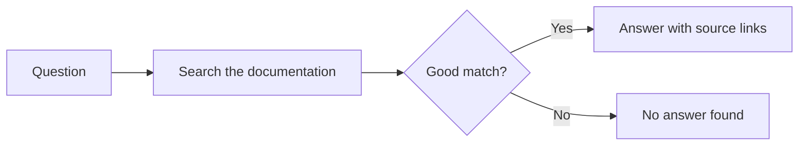

# Diagramming AI systems for readers

Most AI system diagrams are drawn by engineers, for engineers, and then pasted into
user docs unchanged. They show vector databases and model names to readers who wanted
to know whether they can trust the result. This page is a method for drawing the right
diagram for the reader in front of you.

## Ready-to-copy diagrams

The following files contain diagrams you can copy, each with a title and a text
description:

| File | Diagrams for |
|---|---|
| [rag.md](rag.md) | RAG systems: at a glance, content lifecycle, request path, agent with MCP, before and after |
| [jev.md](jev.md) | Jev systems: at a glance, confidence routing, question set |
| [hybrid.md](hybrid.md) | Hybrid systems: route then answer, check passages before answering, verify after answering |

## Step 1: pick the reader's question, not the system

Every diagram answers one question. Write it down before you draw. The following
table matches common readers with the question they ask and the diagram that answers
it:

| Reader | Their question | Diagram |
|---|---|---|
| End user | Where does this answer come from? | At a glance (3 to 4 boxes) |
| Operator or support | Why did it answer that way, and what changes it? | Content lifecycle |
| Evaluator or developer | What happens at each step? | Request path |

## Step 2: use the reader's words

Label boxes with what happens, not what the component is called. The following
table shows common replacements:

| Instead of | Write |
|---|---|
| Vector DB | Indexed content |
| Embedding model | Understands meaning |
| Retriever | Finds relevant passages |
| LLM | Writes the answer |
| Chunking | Splits pages into passages |
| Discriminative model | Decides which option fits |
| Confidence threshold | How sure it must be to act |

Keep component names for developer diagrams, and even then put the plain label first.

## Step 3: show the failure path

A diagram with only a happy path implies the system always succeeds. Add the branch
for "nothing matched well" or "not confident enough" and show what the reader gets. It's the single most
useful line on the diagram.

## Step 4: keep it small

Apply the following limits:

- One diagram, one question.
- Five to seven boxes at most. Split anything larger.
- Flow in one direction, left to right or top to bottom.
- No color as the only carrier of meaning.

## Step 5: write a text alternative that carries the content

A screen reader user, and an AI agent reading your docs, both get the text
alternative instead of the picture. Describe the flow, not the image. The following
table compares a weak and a strong text alternative:

| Weak | Strong |
|---|---|
| "RAG architecture diagram" | "A question is used to search indexed content, the most relevant passages are selected, and an answer is written from them with source links. If nothing matches well, the reader is told and pointed to support." |

For Mermaid diagrams, give the reader the description in two places:

- Put an introductory sentence and a one-paragraph description before the diagram, so
  every reader gets the same information as plain text.
- Add `accTitle` and `accDescr` lines inside the diagram, so screen readers announce
  a title and description for the rendered image.

The following example shows both:

````markdown
The following diagram shows where an answer comes from. A question is used to search
the documentation. If a passage matches well, the reader gets an answer with source
links; if not, the system says so.


````

For images, write the same description as the image's alt text. Don't start alt text
with "Image of" or "Diagram of".

## Step 6: keep it in text

Draw diagrams as code (Mermaid works in GitHub, GitLab, Docusaurus, and most docs
tools) so they're reviewed in pull requests, searchable, and readable by AI agents.
A PNG goes stale silently.

## Further reading

The following pages cover related topics:

- [How AI uses your content](../../write-for-ai/01-how-ai-uses-your-content.md)
- [Writing docs AI can use](../../write-for-ai/06-writing-docs-ai-can-use.md)
