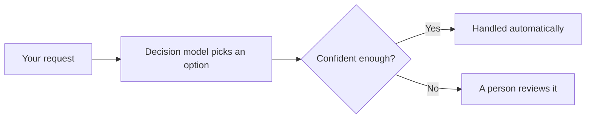
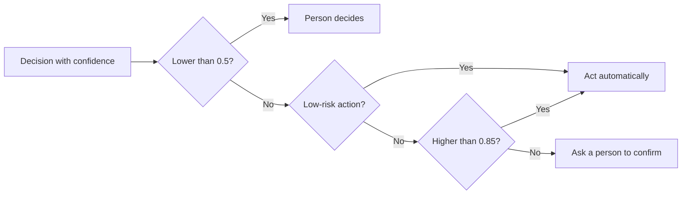
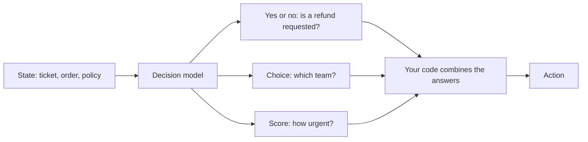

<!--
SECTION TEMPLATE: Decision model diagrams (reference page)
Purpose: Give each kind of reader a diagram of the system at the level of detail
they need, with a text description that carries the same information.
Audience: Technical writers and engineers who add diagrams to documentation about a decision-model system.
Internal or external:
- External: keep the end-user and evaluator diagrams, and describe what the reader
  gets rather than internal components.
- Internal: add component names, owners, and dashboard links to the operator and
  developer diagrams.
Before you write, ask the builders:
- Which inputs does the model receive, and where does each one come from?
- What happens at each confidence level: act, ask a person, or refuse?
- Who reviews a decision, and how is a reversal recorded?
Rules:
- Follow the writing style in ../style.md.
- Keep accTitle and accDescr in every diagram, and put a text description before
  each diagram.
- Delete the diagrams for readers you don't have.
Agent notes:
- Infer from the code: the inputs, the questions, and the action at each confidence
  level.
- Ask a person: who reviews decisions and which component names may be published.
Delete this comment before you publish.
-->

# Decision model diagram templates

This page contains Mermaid diagrams for documenting a decision-model system, one for each kind
of reader. Copy a diagram and its description into any Markdown file that renders
Mermaid. Each diagram includes an `accTitle` and an `accDescr`, which screen readers
announce, and a description to place before the diagram so every reader gets the
same information. For the method behind these diagrams, see
[Diagramming AI systems for readers](README.md).

## Who this page is for

This page is for technical writers and engineers who add diagrams to documentation about a decision-model system.

## Prerequisites

You need a Markdown renderer that supports Mermaid, such as GitHub or [your docs platform].

## At a glance (end users and people affected)

The following diagram shows how a request is handled. A decision model reads the
request and picks the best matching option. If it's confident, the system acts
automatically. If it isn't, a person decides.

## Confidence routing (operators and support)

The following diagram shows how confidence controls actions. Low-risk actions happen
at moderate confidence. High-risk actions need high confidence or a person's
confirmation. Anything under the lowest threshold goes to a person.

## Question set (developers and writers)

The following diagram shows how several questions about one state become an action.
The state is evaluated against several questions at once, and each question is
answered independently. Code combines the answers into an action.

