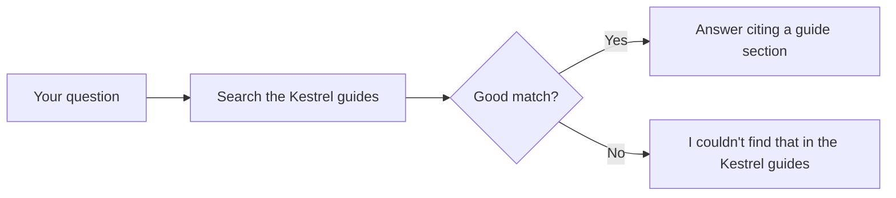
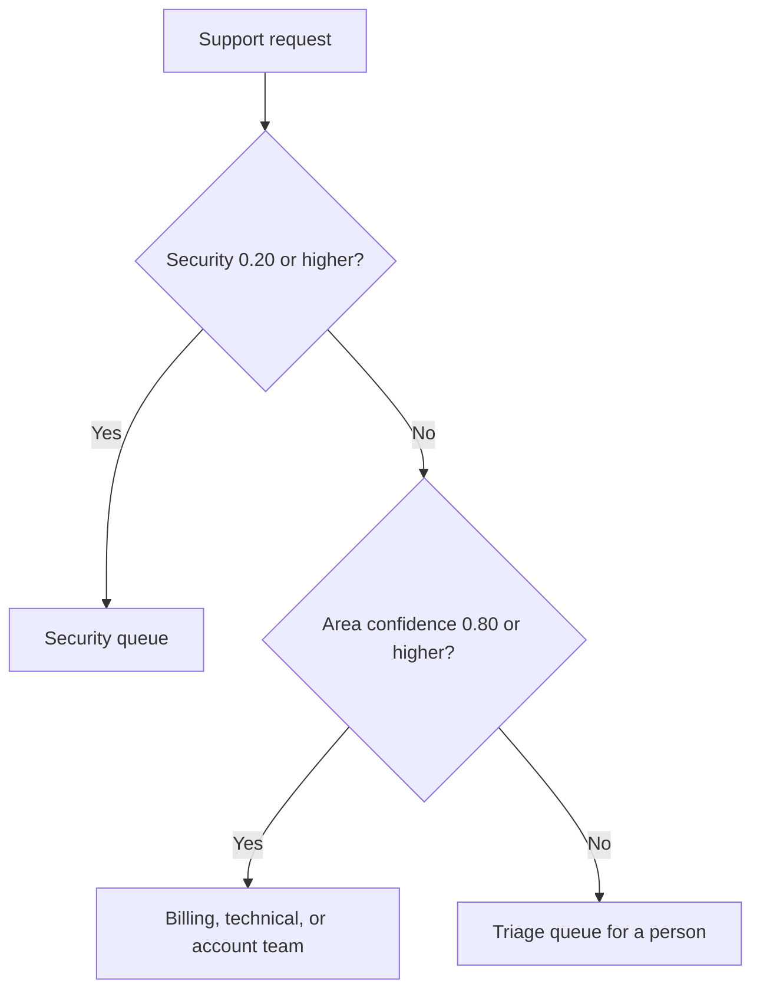
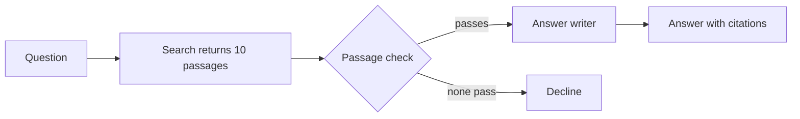

<!--
EXAMPLE: Diagrams, filled in
This page fills in one diagram from each diagram template: RAG (DGM-01), decision
model (DGM-02), and hybrid (DGM-03), for the fictional Kestrel systems in the
other examples. Kestrel is a fictional hosting platform for web apps. The values
match the RAG, decision model, and hybrid examples.
Delete this comment before you copy this page.
-->

# Kestrel diagrams, filled in

This example shows one diagram from each template, drawn for a Kestrel system. Each
diagram has a text description before it, so the page works without the image.

## RAG diagram (DGM-01)

The at-a-glance diagram, for customers of the Kestrel docs assistant. Your question
searches three Kestrel guides. A good match returns an answer that cites a guide
section. Otherwise, the assistant says it couldn't find the answer.

## Decision model diagram (DGM-02)

The confidence routing diagram, for Kestrel support leads. The security check runs
first. Then the area answer routes the request to a team at 0.80 confidence or
higher, or to a person below that.

## Hybrid diagram (DGM-03)

The check passages before answering diagram, for the Kestrel checked documentation
assistant. Search returns 10 passages, a decision model checks each, and only the
passages that pass reach the answer writer.

