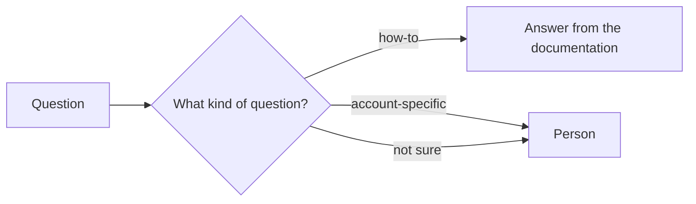
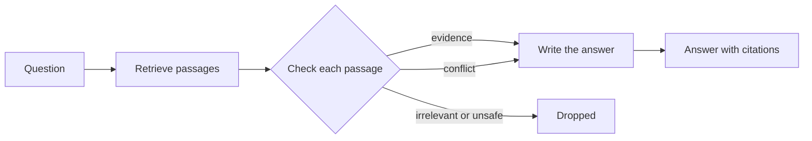
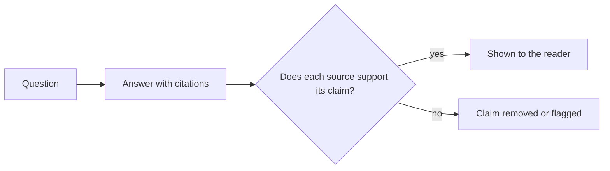
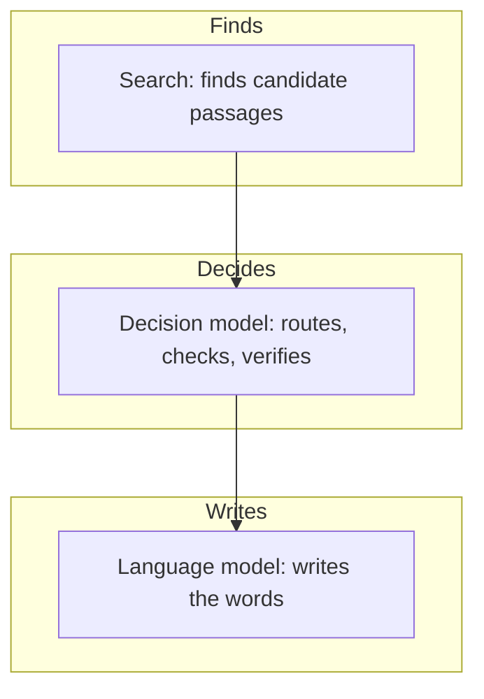

# Hybrid diagram templates

This page contains Mermaid diagrams for documenting a system that combines a decision
model with retrieval and a language model. Copy a diagram and its description into
any Markdown file that renders Mermaid. Each diagram includes an `accTitle` and an
`accDescr`, which screen readers announce, and a description to place before the
diagram so every reader gets the same information. For the method behind these
diagrams, see [Diagramming AI systems for readers](README.md).

## Route, then answer

The following diagram shows a system that classifies each question before answering
it. How-to questions get an answer from the documentation. Account-specific and
uncertain questions go to a person.

## Check passages before answering

The following diagram shows a system that checks each retrieved passage before the
answer is written. Relevant evidence goes to the answer writer, conflicting passages
are passed along separately, and irrelevant or unsafe passages are dropped.

## Verify after answering

The following diagram shows a system that checks an answer's citations before the
reader sees it. Unsupported claims are removed or flagged.

## Who decides what (any hybrid system)

The following diagram shows which part of a hybrid system does what, so readers don't
assume that one AI did everything.

