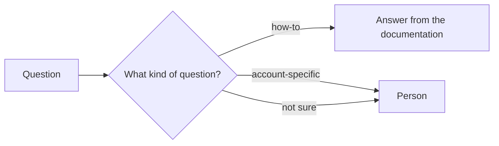
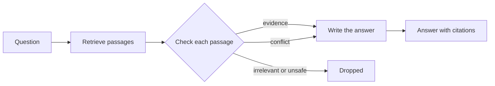
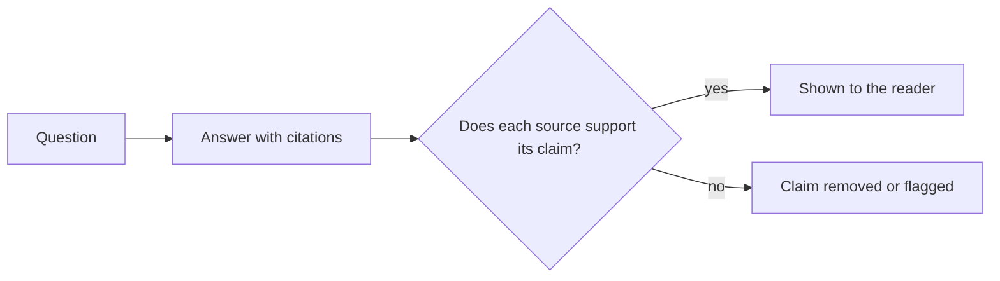
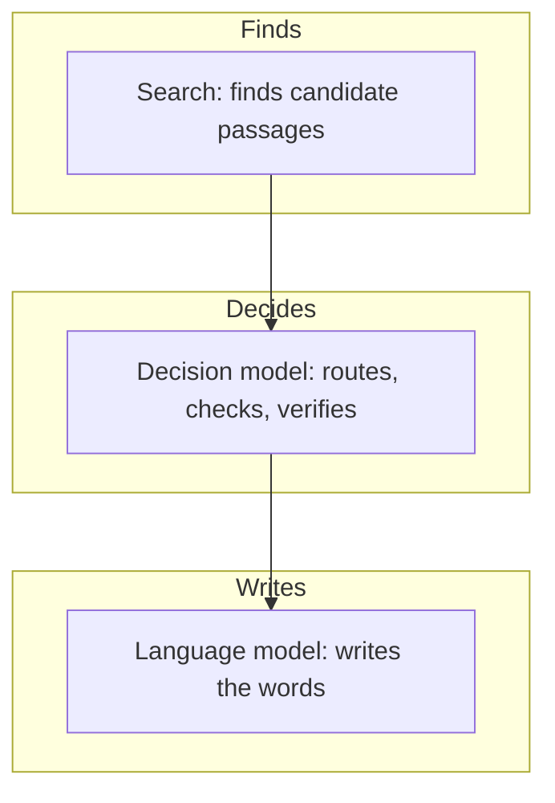

<!--
SECTION TEMPLATE: Hybrid diagrams (reference page)
Purpose: Give each kind of reader a diagram of the system at the level of detail
they need, with a text description that carries the same information.
Audience: Technical writers and engineers who add diagrams to documentation about a hybrid system.
Internal or external:
- External: keep the end-user and evaluator diagrams, and describe what the reader
  gets rather than internal components.
- Internal: add component names, owners, and dashboard links to the operator and
  developer diagrams.
Before you write, ask the builders:
- Which pattern does the system follow, and in what order do the parts run?
- What does each part hand to the next?
- What happens when one part fails or is unsure?
Rules:
- Follow the writing style in ../style.md.
- Keep accTitle and accDescr in every diagram, and put a text description before
  each diagram.
- Delete the diagrams for readers you don't have.
Agent notes:
- Infer from the code: the pattern, the order the parts run in, and what each part
  hands to the next.
- Ask a person: what happens when a part fails and which component names may be
  published.
Delete this comment before you publish.
-->

# Hybrid diagram templates

This page contains Mermaid diagrams for documenting a system that combines a decision
model with retrieval and a language model. Copy a diagram and its description into
any Markdown file that renders Mermaid. Each diagram includes an `accTitle` and an
`accDescr`, which screen readers announce, and a description to place before the
diagram so every reader gets the same information. For the method behind these
diagrams, see [Diagramming AI systems for readers](README.md).

## Who this page is for

This page is for technical writers and engineers who add diagrams to documentation about a hybrid system.

## Prerequisites

You need a Markdown renderer that supports Mermaid, such as GitHub or [your docs platform].

## Route, then answer

The following diagram shows a system that classifies each question before answering
it. How-to questions get an answer from the documentation. Account-specific and
uncertain questions go to a person.

## Check passages before answering

The following diagram shows a system that checks each retrieved passage before the
answer is written. Relevant evidence goes to the answer writer, conflicting passages
are passed along separately, and irrelevant or unsafe passages are dropped.

## Verify after answering

The following diagram shows a system that checks an answer's citations before the
reader sees it. Unsupported claims are removed or flagged.

## Who decides what (any hybrid system)

The following diagram shows which part of a hybrid system does what, so readers don't
assume that one AI did everything.

