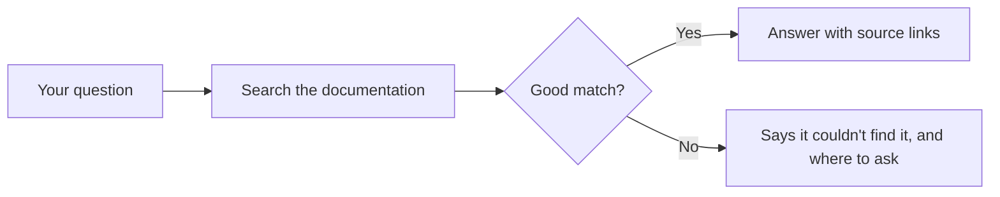
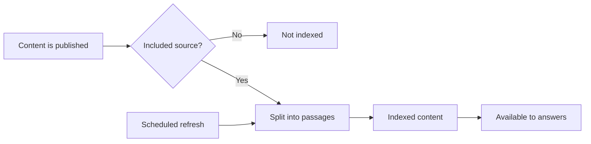
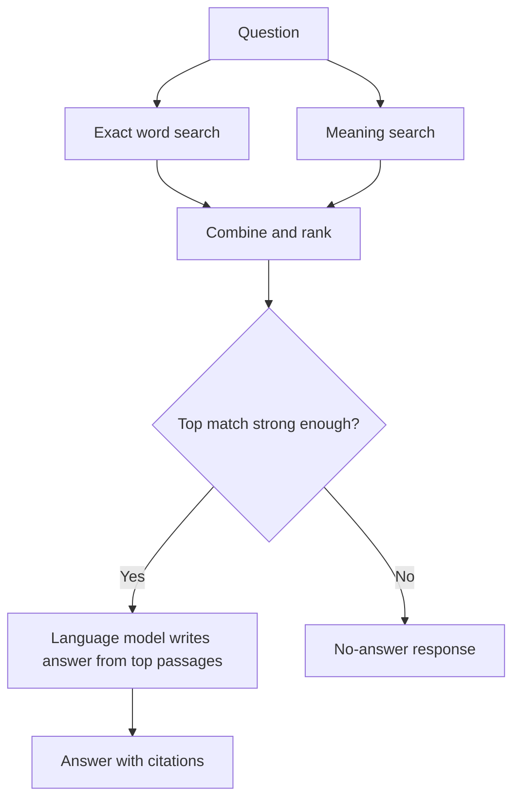
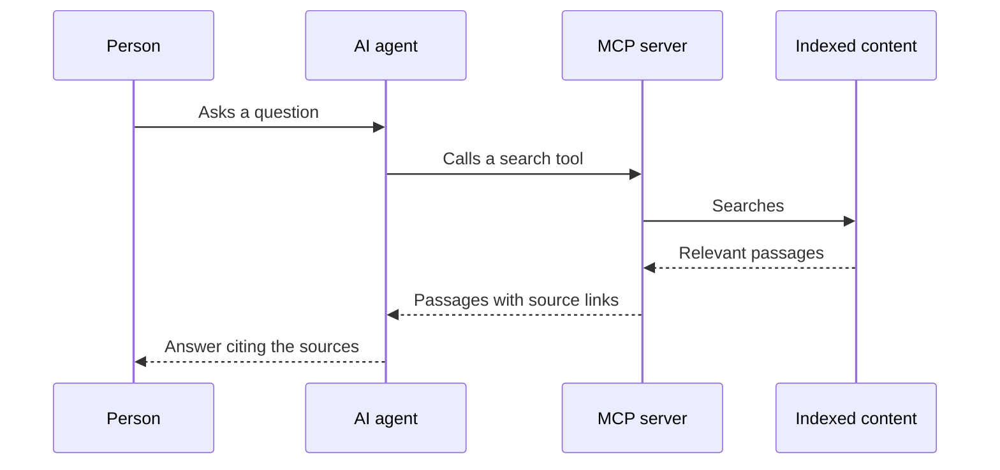
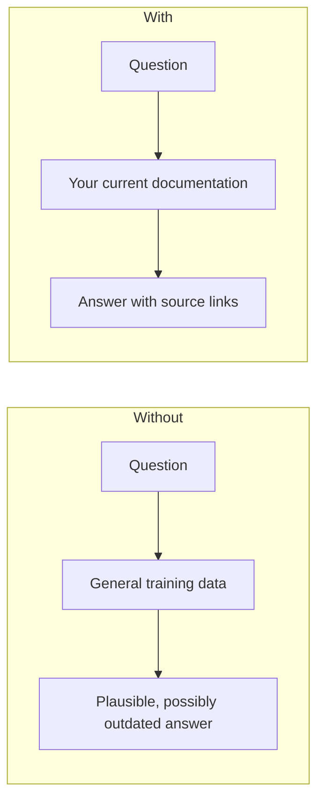

<!--
SECTION TEMPLATE: RAG diagrams (reference page)
Purpose: Give each kind of reader a diagram of the system at the level of detail
they need, with a text description that carries the same information.
Audience: Technical writers and engineers who add diagrams to documentation about a RAG system.
Internal or external:
- External: keep the end-user and evaluator diagrams, and describe what the reader
  gets rather than internal components.
- Internal: add component names, owners, and dashboard links to the operator and
  developer diagrams.
Before you write, ask the builders:
- Which components does a request pass through, in order?
- What happens when no passage matches well?
- How does content get from its source into the index, and how often?
Rules:
- Follow the writing style in ../style.md.
- Keep accTitle and accDescr in every diagram, and put a text description before
  each diagram.
- Delete the diagrams for readers you don't have.
Agent notes:
- Infer from the code: the components a request passes through and how content reaches
  the index.
- Ask a person: which component names may be published and which reader each diagram
  is for.
Delete this comment before you publish.
-->

# RAG diagram templates

This page contains Mermaid diagrams for documenting a retrieval-augmented generation
(RAG) system, one for each kind of reader. Copy a diagram and its description into
any Markdown file that renders Mermaid. Each diagram includes an `accTitle` and an
`accDescr`, which screen readers announce, and a description to place before the
diagram so every reader gets the same information. For the method behind these
diagrams, see [Diagramming AI systems for readers](README.md).

## Who this page is for

This page is for technical writers and engineers who add diagrams to documentation about a RAG system.

## Prerequisites

You need a Markdown renderer that supports Mermaid, such as GitHub or [your docs platform].

## At a glance (end users)

The following diagram shows where an answer comes from. A question is used to search
indexed content, the most relevant passages are selected, and an answer is written
from them with links to its sources. If nothing matches well, the reader is told and
pointed to other help.

## Content lifecycle (operators and support)

The following diagram shows how content reaches answers. Content is published, split
into passages, and indexed. A refresh repeats this on a schedule, so edits reach
answers after the next refresh. Excluded content never enters the index.

## Request path (evaluators and developers)

The following diagram shows each step of a request. A question is searched by exact
words and by meaning. The two result lists are combined and ranked, and the top
passages go to a language model that is instructed to answer only from them. A weak
top match produces a no-answer response instead.

## AI agent with an MCP server (context engineers)

The following diagram shows how an AI agent uses a Model Context Protocol (MCP)
server. An AI agent, such as one in a code editor or chat app, calls a tool on the
MCP server. The server searches indexed content and returns passages with their
sources, and the agent uses them in its reply.

## Before and after (marketing and evaluators)

The following diagram compares an answer with and without access to the content.
Without it, an agent answers from what it learned in training, which may be outdated
or wrong. With it, the agent answers from the current documentation.

