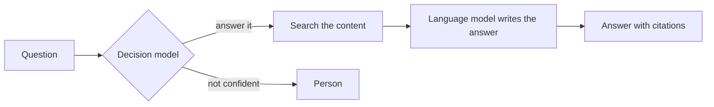

<!--
SECTION TEMPLATE: System overview (concept page)
Purpose: Explain which parts the system has, the order work passes through them, and
what each part is and isn't responsible for. Readers assume "the AI" did everything
unless this page tells them otherwise.
Audience: Everyone.
Internal or external:
- External: describe parts by what they do. Naming the model or vendor behind each
  part is your organization's decision.
- Internal: name every component and version, and link to its owner and code.
Before you write, ask the builders:
- Which parts does a request pass through, in order?
- Which parts generate text, which make decisions, and which are ordinary code?
- Which pattern does the system follow: route then answer, check passages then
  answer, answer then verify, or a combination?
Rules:
- Follow the writing style in ../style.md.
- Document each part in its own set as well: use the RAG templates for retrieval and
  generation, and the decision-model templates for each decision.
Agent notes:
- Infer from the repo: the components, their order, and the interfaces between them.
- Ask a person: who owns each component and who the system is for.
Delete this comment before you publish.
-->

# About [system name]

[System name] [what it does, for whom]. It combines [number] parts: [a decision model
that ..., a search over ..., and a language model that ...].

## Who this page is for

This page is for architects and developers who combine retrieval with a decision step.

## Prerequisites

Before you begin, make sure you have the following:

- A read of [About retrieval-augmented generation](../rag/03-concepts-overview.md)
- A read of [About the decision model](../decision-model/03-concepts-overview.md)

## How a request flows

[Describe the flow in one or two sentences, for example "A decision model classifies
each question. How-to questions are answered from the documentation by a language
model; account questions go to a person."]

The following diagram shows how a request passes through each part:

## Pattern

[System name] follows the [pattern name] pattern. [Keep the paragraph that matches
your system and delete the others.]

- **Route, then answer:** A decision model classifies each request first, and code
  sends it to the right handler: a generated answer, fixed logic, a specialist, or a
  person.
- **Retrieve, check passages, then answer:** Search finds candidate passages, a
  decision model checks each one, and only passages that pass reach the language
  model.
- **Answer, then verify:** A language model answers with citations, and a decision
  model checks whether each cited passage supports its claim before the answer is
  shown.

## What each part is responsible for

The following table lists each part, what kind of component it is, and what it is and
isn't responsible for:

| Part | Kind | Responsible for | Not responsible for |
|---|---|---|---|
| [Request classifier] | Decision model | [Choosing how the request is handled] | [Writing anything] |
| [Search] | Retrieval | [Finding candidate passages] | [Judging whether they answer the question] |
| [Passage checker] | Decision model | [Dropping irrelevant or unsafe passages] | [Ranking passages] |
| [Answer writer] | Language model | [Writing the answer from passages that passed] | [Choosing which passages it sees] |
| [Routing rules] | Code | [Applying thresholds and fixed rules] | [Judging content] |

## What readers see

[Describe which parts' work is visible to the reader, for example "Every answer shows
its citations. Questions sent to a person show the message 'A member of the team will
reply within one business day.'"]

## Next steps

To continue, see the following pages:

- To see what passes between the parts, see [Handoffs](04-handoffs.md).
- To see what happens when a part fails, see [Failure modes](05-failure-modes.md).
- To find the part that produced a bad result, see [Trace a result](06-trace-a-result.md).
