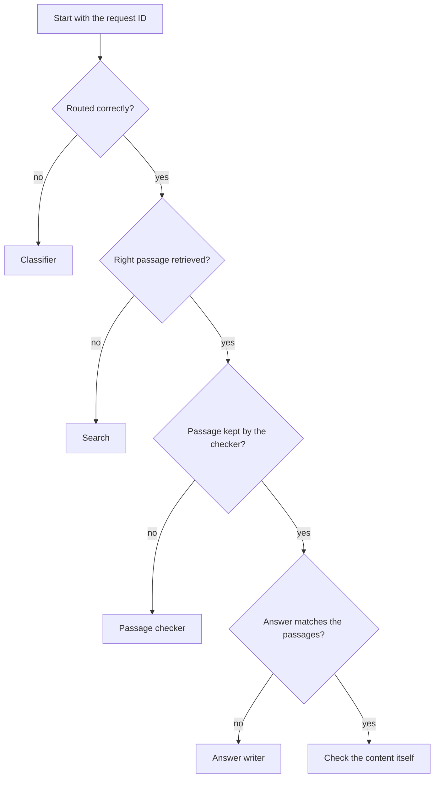

<!--
SECTION TEMPLATE: Trace a result (task page)
Purpose: Give operators a procedure to follow one result through every part, so they
can find the part that caused a bad result instead of guessing.
Audience: Operators, support, and developers.
Internal or external:
- External: usually omit, or describe only the information a customer should send to
  support.
- Internal: include the exact log locations, queries, and dashboards.
Before you write:
- Trace three real results yourself: one good, one wrong, and one sent to a person.
- Confirm that every part logs enough to reconstruct what it received and returned.
Rules:
- Follow the writing style in ../style.md.
- Order the steps in the same order the request passes through the parts.
Delete this comment before you publish.
-->

# Trace a result

This page shows you how to follow one result through every part of [system name], so
you can find the part that caused a problem.

## Who this page is for

This page is for support staff and developers who explain a specific result.

## Prerequisites

Before you begin, make sure you have the following:

- The request identifier or trace for the result

## Before you begin

To trace a result, you need the following:

- [Access to the logs or dashboard, with a link to request it]
- The [request ID] of the result. [State where to find it, for example "It appears
  under each answer when you click **Details**."]

## Find the part that caused the result

To trace a result, do the following:

1. In [location], search for the [request ID].
2. Check the [request classifier]'s decision. Note the chosen option and its
   confidence. If the request was sent to the wrong handler, the classifier caused
   the problem; see [Questions and criteria](../jev/07-questions-and-criteria.md).
3. Check the passages that [search] retrieved. If the passage that answers the
   question isn't in the list, retrieval caused the problem; see
   [Troubleshoot](../rag/11-troubleshooting.md).
4. Check the [passage checker]'s result for each passage. If the passage that answers
   the question was dropped, note the reason. The checker caused the problem.
5. Compare the answer with the passages that reached the [answer writer]. If the
   answer says something the passages don't, the answer writer caused the problem.

The following diagram summarizes the procedure:

If every part behaved correctly, the problem is probably in the content. Check whether
the source is accurate and current.

## Record what you found

After you trace a result, [describe where to record it, for example "add the request
ID and the part that caused the problem to the weekly review sheet"], so repeated
problems in one part are visible.
