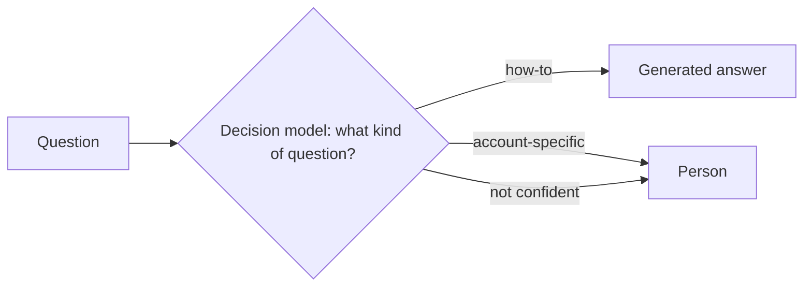
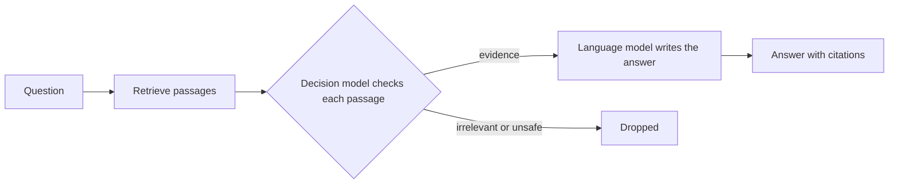
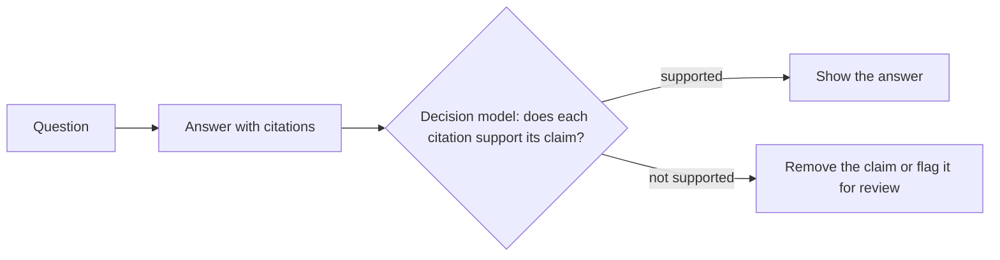

# Hybrid section templates

These are *section templates*. Each one is a template for one page (or one section
of your documentation site) about a system that combines a decision model, such as
Jev, with retrieval-augmented generation (RAG). They aren't a single document to fill
in from top to bottom. Pick the pages your readers need, copy each into your
documentation site, replace the bracketed placeholders, and delete the guidance
comments.

Use them together with the [RAG templates](../rag/) and the [Jev templates](../jev/).
Those document each part. These document how the parts work together, which is where
hybrid systems surprise people.

The templates work for internal and external documentation. Each template's guidance
comment says what to add or remove for each.

## Who these templates are for

These templates are for architects, developers, technical writers, and reviewers who
document a system that retrieves content, makes decisions about it, and writes
answers. The [concepts page](02-concepts.md) defines the terms that are specific to
combining the parts.

## What is a hybrid system?

A *hybrid system*, in this documentation, uses both RAG and a decision model. RAG
finds content and writes text from it. A decision model makes typed judgments, such as
"is this passage relevant?" For the definitions of each technique, see
[About retrieval-augmented generation](../rag/03-concepts-overview.md) and
[About Jev](../jev/03-concepts-overview.md).

## Before you start

Before you use these templates, make sure you have the following:

- Documentation for each part, started from the RAG and Jev sets
- A working copy of the whole system that you can trace a request through
- A read of [How to use these templates](../how-to-use.md)
- A read of [Writing style for these templates](../style.md)

## Common hybrid patterns

Most hybrid systems follow one of three patterns, or combine them.

### Route, then answer

A decision model classifies each request first, and code sends it to the right
handler: a generated answer, fixed logic, a specialist, or a person. The following
diagram shows this pattern:

### Retrieve, check passages, then answer

Search finds candidate passages, and a decision model checks each one: is it relevant,
does it contain usable evidence, and does it try to instruct the model. Only passages
that pass reach the language model. The following diagram shows this pattern:

### Answer, then verify

A language model answers with citations, and a decision model checks whether each
cited passage supports its claim before the answer is shown. The following diagram
shows this pattern:

## The templates

The following table lists the templates, the question each one answers, who reads
it, and when to write and update it:

| Template | Page type | Answers | Primary audience | Write it | Update it when |
|---|---|---|---|---|---|
| [Tutorial](01-tutorial.md) | Tutorial | How do I add a decision step to a RAG application, step by step? | Developers | When the combined system works end to end | A step, a dependency, or the output changes |
| [Concepts](02-concepts.md) | Concept | What is a hybrid system, and which pattern fits? | Architects, developers, writers | Once, at the start | Your pattern or terms change |
| [System overview](03-system-overview.md) | Concept | Which parts exist, and what is each one responsible for? | Everyone | In planning | A part is added, removed, or reordered |
| [Handoffs](04-handoffs.md) | Concept and reference | What passes between the parts, and what rule decides it? | Developers, operators | While the parts are connected | What crosses a handoff, or its rule, changes |
| [Failure modes](05-failure-modes.md) | Reference | What happens when a part is wrong, unsure, or unavailable? | Operators, support | Before launch, tested by turning each part off | Any part's fallback changes |
| [Trace a result](06-trace-a-result.md) | Task | Which part caused this result? | Operators, support, developers | Before launch | Logging or the order of parts changes |
| [Security and data](07-security-and-data.md) | Concept | Where does untrusted content enter, and which part checks it? | Admins, security reviewers | Before a security review | A check, a part, or retention changes |
| [Evaluation](08-evaluation.md) | Concept | How well does each part, and the whole system, work? | Evaluators, buyers | At launch | Any part changes, because one part can change the whole |

## Write the documentation

Follow these steps to document a hybrid system:

1. **Document each part first,** using the RAG and Jev sets.
2. **Write the system overview,** and confirm the responsibility table with the
   builders.
3. **Turn off each part in a test environment** to fill in the failure modes.
4. **Trace three real results** to write and test the tracing procedure.
5. **Evaluate the parts and the whole separately,** and compare with the simpler
   version.

## Example

The [Kestrel checked documentation assistant example](example-kestrel-checked-docs-assistant.md)
shows the overview, handoffs, failure modes, trace, security, and evaluation templates
filled in for a fictional hosting platform.

## Related pages

The following pages are related to this set:

- [How to use these templates](../how-to-use.md)
- [Documentation best practices for AI systems](../best-practices.md)
- [Writing style for these templates](../style.md)
- [Hybrid diagrams](../diagrams/hybrid.md)
