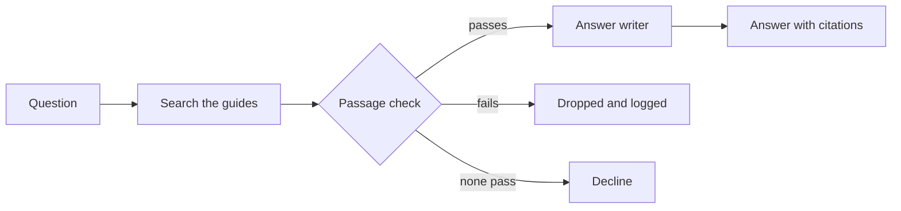

<!--
EXAMPLE: Hybrid documentation, filled in
This page combines the system overview, handoffs, failure modes, trace, security, and
evaluation templates in this folder, filled in for a fictional product, Kestrel, a
hosting platform for web apps. It builds on the RAG example
(../rag/example-kestrel-docs-assistant.md) by adding a decision step that checks each
retrieved passage. For a step-by-step build, see the tutorial (01-tutorial.md).
Kestrel is fictional. The numbers in the evaluation section are invented to show the
format. Replace them with measurements from your own system, and never publish figures
without the method that produced them.
Delete this comment before you copy this page.
-->

# The checked documentation assistant at Kestrel

The checked documentation assistant answers questions about Kestrel from its guides.
It retrieves passages, checks each one against Kestrel's policies, and writes an
answer only from the passages that pass.

## Who this page is for

This page is for support staff and developers who maintain the assistant, and for
reviewers who need to know where each result comes from.

## Prerequisites

Before you use this page, make sure you have the following:

- A read of [About retrieval-augmented generation](../rag/03-concepts-overview.md)
- A read of [About Jev](../jev/03-concepts-overview.md)
- Access to the assistant's request logs, if you investigate a result

## About combining the parts

The assistant follows the retrieve, check passages, then answer pattern. For the
definition, see [About combining retrieval and decisions](02-concepts.md).

The following diagram shows how a question passes through each part:

The following table lists each part and what it's responsible for:

| Part | Kind | Responsible for | Not responsible for |
|---|---|---|---|
| Search | Retrieval | Finding 10 candidate passages | Judging whether they apply to the reader |
| Passage check | Decision model | Answering three yes-or-no questions about each passage | Writing text |
| Answer writer | Language model | Writing the answer from the kept passages, with citations | Choosing which passages it sees |

## Handoffs

The following table lists what passes between the parts, and the rule that applies:

| From | To | What passes | Rule |
|---|---|---|---|
| Search | Passage check | Up to 10 passages, each with its source and version | None. Every candidate is checked. |
| Passage check | Answer writer | Passages that pass | `answers_question` of 0.60 or higher, `matches_version` of 0.60 or higher, and `contains_instructions_for_model` lower than 0.20 |
| Answer writer | Reader | The answer and its citations | The answer must cite at least one kept passage. |

## Failure modes

The following table lists what the assistant does when a part is wrong, unsure, or
unavailable:

| What goes wrong | What the assistant does | What the reader sees |
|---|---|---|
| Search returns nothing | Declines | "I couldn't find that in the Kestrel guides." |
| The passage check is unavailable | Fails closed: declines and logs the failure | "The answer can't be checked right now. Try again later." |
| The passage check removes every passage | Declines | "I couldn't find an answer for your version." |
| The answer writer is unavailable | Shows the kept passages as links | A list of relevant guide sections |

Kestrel fails closed when the passage check is unavailable, because guidance for the
wrong version can cause an outage.

## Trace a result

To find out which part caused a result, do the following:

1. Copy the request identifier from the answer's **Details** menu.
2. Search the request log for that identifier.
3. Read the candidates, the check answers for each, and the kept passages.
4. Compare the kept passages with the answer.

If the right passage isn't among the candidates, the cause is search. If it's a
candidate that was dropped, the cause is the check. If it was kept and the answer is
still wrong, the cause is the answer writer.

## Security and data

The assistant indexes only Kestrel's own guides. Each passage is checked for text that
tells an AI system what to do, and passages that contain it are dropped. The check
reduces the risk of indirect prompt injection but doesn't remove it, so a person
reviews answers that are about billing or account closure.

## Evaluation

The following table shows how each part and the whole assistant performed on 60
labeled questions. The figures are invented to show the format.

| Measure | Result | What it means |
|---|---|---|
| Right passage among the candidates | 90 percent | Search found it |
| Right passage kept by the check | 85 percent | It survived the check |
| Wrong-version passages removed | 94 percent | The check dropped them |
| Correct, cited answers | 82 percent | The final answer was right |
| Average passages kept | 3.4 | How many reached the answer writer |

Method: [Describe how the questions were chosen, who labeled them, when the test ran,
the model versions, and what the results don't show, including the comparison with the
assistant without the check.]
