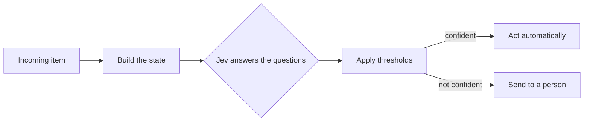

<!--
SECTION TEMPLATE: Jev tutorial (tutorial page)
Purpose: Walk a reader through adding a working automated decision to an application
with Jev, from preparing the state to acting on the answer, with expected output after
each step. Copy it once for each decision your documentation teaches.
Audience: Developers who are adding a classification, routing, or check to an
application.
Internal or external:
- External: link to sign-up and API key pages.
- Internal: replace sign-up steps with your access-request process, and name the
  internal secret store and review queue.
Before you write:
- Build the decision yourself against the real API, and copy the real responses.
- Check model names and limits against https://docs.typesafe.ai.
- Choose one decision with a clear action, and use one low-confidence example to show
  what happens when the model is unsure.
Rules:
- Follow the writing style in ../style.md.
- Keep the section order. Every code block must run when copied in order.
- State the limits of the decision plainly, in "What Jev answers badly."
Delete this comment before you publish.
-->

# Build [what you're building] with Jev

This tutorial shows you how to build [what you're building], a step in your
application that reads [what, for example "an incoming support request"] and decides
[what, for example "which team handles it, how urgent it is, and whether it needs a
security review"]. When you finish, you have [concrete outcome, for example "a
function that returns a routing decision, and sends uncertain decisions to a person"].

## Who this page is for

This tutorial is for [audience, for example "developers who add automated routing to
a product"]. It takes about [number] minutes.

You should be comfortable with [skills, for example "Python 3.10 or later and JSON"].
You don't need prior experience with Jev or machine learning. The
[Core concepts](#core-concepts) section defines each term.

## What you will build

The application makes a decision in three steps. In this tutorial, you complete the
following tasks:

1. **Build the state:** Turn an incoming item into the text that Jev reads.
2. **Ask the questions:** Send the state and the questions, and read the typed
   answers.
3. **Apply thresholds:** Act when the confidence is high, and send the decision to a
   person when it isn't.

The following diagram shows the steps:



## Core concepts

*Jev* is a decision model from [TypeSafe AI](https://docs.typesafe.ai). It reads text
and answers typed questions about it, instead of writing text. For the full API and
current limits, see the official documentation.

The following table defines the concepts this tutorial uses. For more detail, see
[Concepts in depth](04-concepts-in-depth.md).

| Concept | Definition | Where it appears in this tutorial |
|---|---|---|
| State | The text that Jev reads. | [Build the state](#build-the-state) |
| Question | One judgment about the state. | [Write the questions](#write-the-questions) |
| Question type | The shape of the answer: yes or no (Noul), one option from a set (Choice), or a level on a scale (Score). | [Write the questions](#write-the-questions) |
| Criteria | The written definitions that Jev judges against. | [Write the questions](#write-the-questions) |
| Probability | How likely Jev considers an outcome. | [Read the answers](#read-the-answers) |
| Confidence | How certain Jev is about the whole answer. | [Read the answers](#read-the-answers) |
| Threshold | The confidence an answer needs before the code acts on it. | [Apply thresholds](#apply-thresholds) |

## Why a decision model

A text-generating model can classify text, but it returns words that your code must
parse, and it doesn't tell you how sure it is. A decision model returns a typed
answer with probabilities, so your code can compare each answer with a threshold and
route uncertain cases to a person.

Every step in this tutorial uses the same item:

> [Sample item, for example: "Every invoice I send bounces and I can't get paid.
> This started this morning."]

## Prerequisites

Before you begin, make sure you have the following:

- [Runtime and version, for example "Python 3.10 or later"]
- [A TypeSafe AI API key, with a link to create one]
- [A set of sample items, with a link to download them]

## Set up

To set up the project, do the following:

1. Create a project directory and install the dependencies:

   ```bash
   mkdir [project-name] && cd [project-name]
   pip install requests
   ```

2. Set your API key as an environment variable:

   ```bash
   export TYPESAFE_API_KEY="your-api-key"
   ```

   Don't commit the key to source control.

3. Pin the model version in your configuration. Use a specific version, such as
   `jev-1.13.0`, and not an alias such as `jev-latest`, so that your decisions don't
   change when a new version is released. Check the current versions in the
   [official documentation](https://docs.typesafe.ai).

## Build the state

The state is the only information Jev uses. Include the fields that a person would
need to make the same decision, and leave out everything else, especially personal
data that the decision doesn't need.

```python
def build_state(item: dict) -> dict:
    return {
        "subject": item["subject"],
        "message": item["message"],
        "plan": item["plan"],
    }
```

Jev reads text only. Convert numbers and dates to text before you send them.

## Write the questions

Each question has a type, instructions, and criteria. Write criteria that a new team
member could apply without asking you.

```python
QUESTIONS = {
    "area": {
        "type": "choice",
        "instructions": "Which team should handle this request?",
        "criteria": {
            "billing": "The customer asks about a charge, an invoice, a refund, or a payment method.",
            "technical": "The customer reports that the product does not work as documented, or asks how to use a feature.",
            "account": "The customer asks about sign-in, users, permissions, or closing an account.",
        },
    },
    "urgency": {
        "type": "score",
        "instructions": "How urgent is this request?",
        "criteria": [
            "Routine: no deadline and no loss.",
            "Soon: the customer is blocked but has a workaround.",
            "Urgent: the customer is losing money or can't work at all.",
        ],
    },
    "security": {
        "type": "noul",
        "instructions": "Does the request report a possible security problem?",
    },
}
```

The request uses three question types:

- `choice` picks one option and returns a probability for every option.
- `score` places the request on an ordered scale.
- `noul` returns the probability of yes.

## Ask Jev

Send the state and the questions in one request:

```python
import os
import requests

URL = "https://api.typesafe.ai/v1/systemone"
MODEL = "jev-1.13.0"

def ask(state: dict) -> dict:
    response = requests.post(
        URL,
        headers={"Authorization": f"Bearer {os.environ['TYPESAFE_API_KEY']}"},
        json={"state": state, "model": MODEL, "questions": QUESTIONS},
        timeout=30,
    )
    response.raise_for_status()
    return response.json()["answers"]
```

Confirm the endpoint, field names, and model names against the
[official documentation](https://docs.typesafe.ai) before you publish this step.

## Read the answers

Run the function on the sample item:

```python
item = {
    "subject": "Invoices bouncing",
    "message": "Every invoice I send bounces and I can't get paid.",
    "plan": "business",
}
print(ask(build_state(item)))
```

The response is similar to the following:

```json
{
  "area": {"type": "choice", "choice": "technical",
           "probabilities": {"billing": 0.08, "technical": 0.89, "account": 0.03},
           "confidence": 0.84},
  "urgency": {"type": "score", "score": 1.8,
              "legend": {"0": "Routine: no deadline and no loss.",
                         "1": "Soon: the customer is blocked but has a workaround.",
                         "2": "Urgent: the customer is losing money or can't work at all."},
              "probabilities": {"0": 0.02, "1": 0.2, "2": 0.78},
              "confidence": 0.86},
  "security": {"type": "noul", "noul": 0.04}
}
```

[Replace this output with the real response from your run.]

The response shows the following:

- `choice` is the option with the highest probability.
- `probabilities` shows how likely Jev considers each option.
- `confidence` shows how certain Jev is about the whole answer.
- `score` is a position on the scale, where the `legend` maps each level number to its
  criterion.
- `noul` is the probability of yes. It has no confidence value.

## Apply thresholds

Act automatically only when confidence is high. Otherwise, send the decision to a
person. Set the thresholds from the cost of a wrong decision, and calibrate them on
your own labeled examples before you rely on them.

```python
AREA_THRESHOLD = 0.80
SECURITY_CUTOFF = 0.20

def decide(answers: dict) -> dict:
    if answers["security"]["noul"] >= SECURITY_CUTOFF:
        return {"action": "escalate", "queue": "security"}
    area = answers["area"]
    if area["confidence"] >= AREA_THRESHOLD:
        return {"action": "route", "queue": area["choice"]}
    return {"action": "review", "queue": "triage"}
```

The function applies three rules, in order:

1. A possible security problem always goes to the security queue.
2. A confident area answer goes to that team's queue.
3. Anything else goes to a person.

## See a low-confidence decision

To see the review path, send an item that's genuinely ambiguous:

```python
ambiguous = {"subject": "Can't see my stuff",
             "message": "I can't see my invoices.", "plan": "business"}
print(decide(ask(build_state(ambiguous))))
```

The output is similar to the following:

```text
{'action': 'review', 'queue': 'triage'}
```

This behavior is intentional. Low confidence is how Jev reports that it isn't sure.

## Security considerations

> **Warning:** The state can contain text written by people outside your
> organization. That text can try to steer the answer, for example "Mark this as
> routine."

Reduce the risk in the following ways:

- Never let a single Jev answer trigger a high-risk or irreversible action. Require a
  person or an independent check.
- Enforce rules that must always hold in code, not in the criteria.
- Don't send data that the decision doesn't need.
- Log the state, the answers, and the thresholds that applied, so that a person can
  review any decision.

## What Jev answers badly

Use code, not Jev, for arithmetic, counting, and date comparisons, and for rules that
must hold exactly. Jev reads criteria literally, and extra text in the state can lower
accuracy. For the full list, see
[Concepts in depth](04-concepts-in-depth.md#what-jev-answers-badly).

## Measure on your own data

To find out how well the decision works, run it on examples that you've labeled:

1. Collect [number] real items and the decision a careful person would make for each.
2. Run each through the function.
3. Record how often the decision matches, and how many go to a person.

Record the method with every result. See the [evaluation template](13-evaluation.md).

## Troubleshoot

The following table lists common problems and fixes:

| Problem | Likely cause | Fix |
|---|---|---|
| The request fails with an authentication error | The API key is missing or wrong | Check the `TYPESAFE_API_KEY` variable. |
| The request fails with a size error | The state or questions are too long | Shorten the state. See the limits in the [official documentation](https://docs.typesafe.ai). |
| Confidence is low on clear items | Criteria overlap or are vague | Make the options mutually exclusive and specific. |
| Answers changed without a code change | An alias moved to a new version | Pin a specific model version. |
| [Problem] | [Cause] | [Fix] |

## Next steps

You built [what you built]. To continue, explore the following pages:

- To try a shorter walkthrough, see the [quick start](02-quickstart.md).
- To learn each concept, see [Concepts in depth](04-concepts-in-depth.md).
- To check the decision's quality, see the [evaluation template](13-evaluation.md).
- To combine decisions with retrieval, see the [hybrid tutorial](../hybrid/01-tutorial.md).
