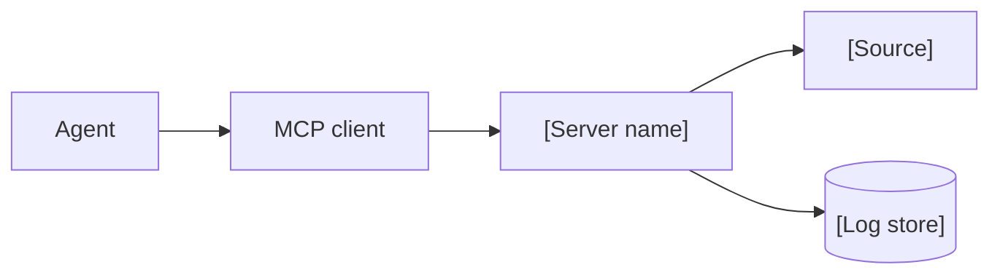

<!--
SECTION TEMPLATE: Security and data (concept page)
Purpose: Explain how data moves through the server, what is logged and kept, and how
exposed the server is to prompt injection.
Audience: Security reviewers, admins approving the server, and users deciding what to
send through it.
Internal or external:
- External: describe data flow, logging, and retention customers can rely on.
- Internal: add storage locations, access lists, and the threat model.
Before you write, ask the builders and your security team:
- What does the server receive in each request, and what does it log?
- Where is that data stored, and for how long?
- Does any tool return content written by third parties, such as web pages, issues,
  or emails?
- Can any tool change data outside the server?
Rules:
- Follow the writing style in ../style.md.
- Describe prompt injection exposure plainly: any tool that returns third-party
  content can carry instructions aimed at the agent.
- State retention for every kind of logged data.
Agent notes:
- Infer from the server code: logged fields, storage, retention jobs, tools that
  fetch third-party content, and tools that write.
- Ask a person: the agreed retention, the legal basis, and anything the security
  team must approve before publishing.
Delete this comment before you publish.
-->

# Security and data for [server name]

This page explains how data moves through [server name], what is logged and kept, and
how the server handles content that could carry instructions aimed at an agent.

## Who this page is for

This page is for security reviewers, admins who approve [server name], and users who
want to know what happens to the data they send.

## Prerequisites

Read [Authentication and permissions](03-authentication-and-permissions.md) first.

## Data flow

The following diagram shows how data moves through [server name].



The flows in the diagram are:

- The agent's tool call travels through the MCP client to [server name].
- [Server name] reads [source] to build the result.
- [Server name] logs [fields] to [log store].

## What is logged and kept

The following table lists each kind of data [server name] keeps:

| Data | Logged | Retention | Who can read it |
|---|---|---|---|
| [Tool arguments] | [Yes or No] | [Period] | [Role] |

## Prompt injection exposure

The following tools return content written by third parties, which can contain
instructions aimed at the agent:

- `[tool_name]`: returns [third-party content].

[What [server name] does to reduce the risk, and what the client or user must still
watch for.]

## Example

The following example shows the logging table filled in for a fictional hosting
platform:

```markdown
| Data | Logged | Retention | Who can read it |
|---|---|---|---|
| Search query text | Yes | 90 days | Kestrel docs team |
| Returned passages | No | Not kept | Nobody |
```
