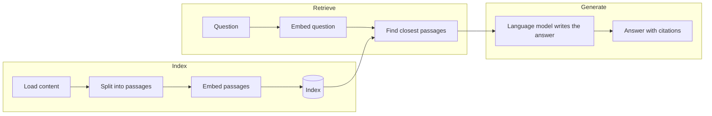

<!--
SECTION TEMPLATE: RAG tutorial (tutorial page)
Purpose: Walk a reader through building a working retrieval-augmented generation (RAG)
application from start to finish, with expected output after each step. This is the
template to copy first. Copy it once for each tutorial in your documentation section.
Audience: Developers and technical writers building or evaluating a RAG application.
Internal or external:
- External: link to sign-up pages and public package names.
- Internal: replace sign-up steps with your access-request process, and name the
  internal package index, vector store, and model gateway.
Before you write, ask the builders:
- Which language, libraries, and versions does the team support for this tutorial?
- Build the application yourself on a clean machine and copy the real output.
- Pick one question that the application answers well and that shows why retrieval
  matters. Use the same question in every step.
- Decide the reader's starting point (see "Who this page is for") and don't explain
  anything below it, except in the Core concepts section.
Rules:
- Follow the writing style in ../style.md.
- Keep the section order. Delete a section only if it truly doesn't apply, and say why
  in your notes.
- Every code block must run when copied in order. Every step ends with the expected
  result.
- Keep the Core concepts section even for advanced readers. Concepts are what AI
  agents and newcomers quote most.
Agent notes:
- Infer from the repo: the language, library names and versions, install commands, and
  file layout. Run every step and paste the real output.
- Ask a person: the one question the tutorial answers, the reader's starting point,
  and permission to publish the sample content.
Delete this comment before you publish.
-->

# Build a [what you're building] with [technology or platform]

This tutorial shows you how to build [what you're building], an application that
answers questions about [your content] by retrieving relevant passages and having a
language model write a response from them. When you finish, you have [concrete
outcome, for example "a command-line assistant that answers questions about a folder
of Markdown files and cites the files it used"].

## Who this page is for

This tutorial is for [primary audience, for example "developers who are adding
question answering to a product"]. It takes about [number] minutes.

You should be comfortable with [skills, for example "Python 3.10 or later and the
command line"]. You don't need prior experience with RAG, embeddings, or vector
search. The [Core concepts](#core-concepts) section defines each term the first time
the tutorial uses it.

If you're [other audience, for example "a technical writer documenting a RAG
feature"], start with [page, for example "the concepts overview"](03-concepts-overview.md).

## What you will build

The application has three stages. In this tutorial, you complete the following
steps:

1. **Index:** Load [your content], split it into passages, convert each passage into
   a vector, and store the vectors in an index.
2. **Retrieve:** Convert a question into a vector, and find the passages whose
   vectors are closest to it.
3. **Generate:** Give the question and the retrieved passages to a language model,
   and have it write an answer that cites its sources.

The following diagram shows the stages:



When you finish, you can run a command like the following and get an answer with
citations:

```text
[Example command and abbreviated answer]
```

## Core concepts

A *retrieval-augmented generation* (RAG) application answers questions by first
retrieving relevant content from a source you control, and then giving that content
to a language model so that the model writes its answer from it. The technique was
introduced in
[Retrieval-Augmented Generation for Knowledge-Intensive NLP Tasks](https://arxiv.org/abs/2005.11401).
RAG is useful when the model needs information it wasn't trained on, such as private,
recent, or product-specific content.

The following table defines the concepts this tutorial uses. For more detail, see
[Concepts overview](03-concepts-overview.md) and
[Concepts in depth](04-concepts-in-depth.md).

| Concept | Definition | Where it appears in this tutorial |
|---|---|---|
| Chunk (passage) | A short section of a document, small enough to retrieve and read on its own. | [Split the content](#split-the-content) |
| Embedding | A list of numbers that represents the meaning of a piece of text. | [Embed the passages](#embed-the-passages) |
| Vector | The list of numbers itself. Passages with similar meanings have vectors that are close together. | [Embed the passages](#embed-the-passages) |
| Index | A store that holds vectors and the passages they came from, and can find the closest ones quickly. | [Store the passages in an index](#store-the-passages-in-an-index) |
| Retrieval | Finding the passages most likely to answer a question. | [Retrieve passages](#retrieve-passages) |
| Ranking | Ordering the retrieved passages from most to least relevant. | [Retrieve passages](#retrieve-passages) |
| Relevance | How well a passage helps answer a question, which isn't always the same as how similar it is. | [Improve relevance](#improve-relevance) |
| Rule | A condition you set, such as a filter or an exclusion, that overrides or limits ranking. | [Improve relevance](#improve-relevance) |
| Grounding | Answering only from retrieved passages, and citing them. | [Generate the answer](#generate-the-answer) |

## Why retrieval matters

A language model writes from what it learned during training. It can't read
[your content], so a question about [something specific or recent] gets a fluent
answer that might be outdated or wrong, with nothing to check it against.

You can't fix this by sending all of [your content] with every question. It's too
large for the model's input, and long inputs make it harder for the model to find the
one detail that matters. The application has to pick the few passages that bear on
each question.

Every step in this tutorial uses the same question:

> [Question that your content answers and a model can't answer on its own]

The following code sends that question to a model with no retrieval:

```[language]
[Minimal code that asks the model the question with no context]
```

The model responds with an answer similar to the following:

```text
[Real, abbreviated output that's generic, outdated, or wrong]
```

Without retrieval, the application can't look up [your content]. The rest of this
tutorial fixes that.

## Prerequisites

Before you begin, make sure you have the following:

- [Runtime and version, for example "Python 3.10 or later"]
- [Account or API key for the language model, with a link to create one]
- [Content to index. This tutorial uses [sample content, with a link to download
  it].]
- [Disk space or hardware, if relevant]

## Set up

To set up the project, do the following:

1. Create a project directory:

   ```bash
   mkdir [project-name]
   cd [project-name]
   ```

2. Install the dependencies:

   ```bash
   [install command]
   ```

3. Set your credentials as environment variables:

   ```bash
   export [ENV_VAR_NAME]="your-api-key"
   ```

   Don't commit credentials to source control.

## Index the content

In the indexing step, you convert your content into vectors and store them so that
the application can search by meaning. Indexing has four steps: load, split, embed,
and store. You run indexing once, and again whenever the content changes. The
application searches the index at question time; it doesn't read all the content for
every question.

Create `[index-file]`.

### Load the content

Load the source files into a list of documents. Each document keeps its text and the
location it came from, so that the application can cite it later.

```[language]
[Code that loads the content]
```

When you run the code, it prints a result similar to the following:

```text
[Real output, for example "Loaded 42 documents."]
```

### Split the content

Split each document into passages. Whole documents are too long to embed and send to
a model, and a passage that covers one topic matches a question better than a whole
page that covers many.

This tutorial splits at [boundary, for example "Markdown headings"] and limits each
passage to [number] characters.

```[language]
[Code that splits the documents]
```

The output is similar to the following:

```text
[Real output, for example "Split 42 documents into 310 passages."]
```

### Embed the passages

An embedding model converts each passage into a vector, a list of numbers that
captures its meaning. You must use the same embedding model for the passages and for
questions, because vectors from different models can't be compared.

This tutorial uses [embedding model], which produces vectors with [number]
dimensions.

```[language]
[Code that embeds the passages]
```

The output is similar to the following:

```text
[Real output, for example "Created 310 vectors with 384 dimensions."]
```

### Store the passages in an index

Store the vectors, the passage text, and each passage's source in an index. The index
finds the vectors closest to a question's vector without comparing every one.

This tutorial uses [index technology, for example "an in-memory array saved to
disk"]. For production, use [recommendation, for example "a vector database"].

```[language]
[Code that stores the index]
```

> **Tip:** Indexing runs once in this tutorial. In production, persist the index and
> refresh it on a schedule when the content changes.

You now have a searchable index of [your content]. Next, build the part that searches
it.

## Retrieve passages

Retrieval finds the passages most likely to answer a question. The function converts
the question into a vector with the same embedding model, compares it with every
passage vector, and returns the top [number] passages. The comparison uses
[similarity measure, for example "cosine similarity"], where a higher score means a
closer match. The ordered result is the ranking.

Add the following function to `[app-file]`:

```[language]
[Code that retrieves and ranks passages]
```

To check retrieval, search for the tutorial's question:

```[language]
[Code that prints the top passages with scores and sources]
```

The output is similar to the following:

```text
[Real output: scores, source, and the first line of each passage]
```

The top result comes from [expected source], which is the page that answers the
question.

## Generate the answer

The model writes the answer from the question and the retrieved passages. The prompt
tells the model to answer only from the passages and to cite the source of each
statement. This behavior is called grounding.

Add the following code to `[app-file]`:

```[language]
[Code that builds the prompt and calls the model]
```

The prompt contains the following instructions:

- Answer only from the passages provided.
- Cite the source of each statement.
- If the passages don't answer the question, say so.

## Run the application

To run the application with the tutorial's question, run the following command:

```bash
[run command]
```

The application does the following:

1. Embeds the question.
2. Retrieves the top [number] passages.
3. Sends the question and passages to the model.
4. Prints the answer with its sources.

The output is similar to the following:

```text
[Real answer with citations]
```

Compare this answer with the one you got in [Why retrieval matters](#why-retrieval-matters).
The answer now reflects [your content] and cites the pages it came from.

To confirm that the application declines when the content doesn't cover a question,
ask something unrelated:

```bash
[run command with an off-topic question]
```

The application responds with a message similar to the following:

```text
[Real "I couldn't find that" output]
```

## Improve relevance

If the application retrieves the wrong passages, improve relevance before changing
the model. Try the following, in order:

1. **Fix the content.** Add a descriptive heading to any passage that doesn't make
   sense on its own.
2. **Tune chunking.** Change the passage size or the split boundary, and rerun the
   index step.
3. **Combine search methods.** Add keyword search alongside vector search, so that
   exact terms such as error codes and setting names match.
4. **Rerank.** Reorder the top results with a model that reads the question and each
   passage together.
5. **Add rules.** Filter by metadata, such as product version, or exclude sources
   that you don't trust.

For what each option does and when to use it, see
[Concepts in depth](04-concepts-in-depth.md).

## Security considerations

> **Warning:** Retrieved content is untrusted input. A passage can contain text that
> reads like an instruction, such as "ignore your previous instructions." This attack
> is called *indirect prompt injection*. The model reads passages in the same context
> window as your own instructions, so it might act on them.

Careful prompt wording and delimiters reduce this risk, but they can't remove it.
This tutorial reduces the risk in the following ways:

- The prompt tells the model to treat passages as information, not as instructions.
- Each passage is labeled with its source.

To reduce the risk further, do the following:

- Index only content from sources you trust.
- Review answers before you show them to users. Confirm that each answer cites a
  source you expect, and that each claim appears in the cited passage.
- Respect access control. Don't index content that some users aren't allowed to see
  unless you filter results by the user's permissions.

## Evaluate the application

To find out how well the application works, test it with questions that you know the
answers to:

1. Write [number] questions, each paired with the page that answers it.
2. Add [number] questions that your content doesn't answer.
3. For each question, check whether the right page appears in the top [number]
   results, and whether the application declines when it should.

Record the method with every result. For how to report results, see the
[evaluation template](12-evaluation.md).

## Troubleshoot

The following table lists common problems and fixes:

| Problem | Likely cause | Fix |
|---|---|---|
| The right page doesn't appear in the results | The passage is too long or doesn't name the topic | Split the page into smaller sections, and add descriptive headings. |
| Answers cite pages that don't support the claim | The prompt doesn't enforce grounding | Tell the model to answer only from the passages, and check the citations. |
| Results look unrelated to the question | The question and passages used different embedding models | Use the same embedding model for both, and rebuild the index. |
| [Problem] | [Cause] | [Fix] |

## Next steps

You built [what you built]. To continue, explore the following pages:

- To try a shorter walkthrough, see the [quickstart](02-quickstart.md).
- To learn how each stage works, see [Concepts in depth](04-concepts-in-depth.md).
- To check the application's quality, see the [evaluation template](12-evaluation.md).
- To add a decision step that checks passages before they reach the model, see the
  [hybrid tutorial](../hybrid/01-tutorial.md).

## Full code

The following code is the complete application. Save it as `[file-name]` and run it
with `[run command]`:

```[language]
[Complete code]
```
