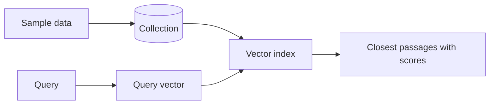

<!--
SECTION TEMPLATE: RAG quick start (tutorial page)
Purpose: Get a reader from nothing to a first working semantic (vector) search or RAG
answer in 10 to 20 minutes, using sample data you provide. A quick start is shorter
than the tutorial: it uses prepared data, makes the fewest choices, and ends with a
learning summary.
Audience: Developers evaluating or starting with your RAG or vector search feature.
Internal or external:
- External: link to sign-up and API key pages, and use public sample data.
- Internal: link to access requests, and use sample data from a shared staging index.
How it differs from the tutorial (01-tutorial.md):
- The quick start uses a prepared dataset. The tutorial builds the whole pipeline.
- The quick start teaches one capability. The tutorial teaches the end-to-end flow.
Before you write:
- Complete the quick start on a clean account, and time yourself. Put that time in
  "Time required."
- Prepare sample data that needs no cleanup, and test the exact query you show.
- If a feature is in preview, say so in a note at the top.
Rules:
- Follow the writing style in ../style.md.
- Show the expected output after every step that produces one.
- If readers choose between deployment types or interfaces, give each choice its own
  tab or labeled subsection, and keep the steps parallel.
Delete this comment before you publish.
-->

# [Product or feature] quick start

[Preview or limitation note, if any. For example: "This feature is in preview and
might change. Don't use it in production."]

## About this task

This quick start shows you how to load [sample data], create an index for it, and run
[a semantic search | a RAG query] that returns [what, for example "the passages most
similar in meaning to a question"].

*Time required: [number] minutes*

### Who this quick start is for

This quick start is for [audience, for example "developers who are new to vector
search"]. You should be comfortable with [skills]. You don't need prior experience
with vectors or embeddings.

### What you'll learn

In this quick start, you complete the following steps:

1. Load [sample data] into [location].
2. Create an index definition for the `[field]` field. The index stores each passage
   as a vector so that you can search by meaning.
3. Run a query that searches the index and returns the [number] most similar
   passages, each with a similarity score.

To learn more about the concepts you use, see the
[Learning summary](#learning-summary).

## Concepts you'll use

*Vector search* finds items by meaning instead of by exact words. It works in three
parts:

- An *embedding model* converts text into a *vector*, a list of numbers that
  represents its meaning.
- An *index* stores the vectors and finds the ones closest to a query vector.
- A *similarity score* measures how close two vectors are. A higher score means a
  closer match.

*Retrieval-augmented generation* (RAG) uses vector search to find passages and then
gives those passages to a language model so that it can write a grounded answer. For
the full definition, see the
[concepts overview](03-concepts-overview.md).

## Before you begin

Before you begin, make sure you have the following:

- [Account, with a link to create one]
- [Role or permission, for example "Project Owner"]
- [Tools and versions, for example "Python 3.10 or later"]
- [API keys, with a link to create them, and a note about which keys work]

## Architecture

This quick start creates the following architecture:

- [Component 1, for example "A free-tier cluster with sample data loaded"]
- [Component 2, for example "A vector index on the `[field]` field"]

> **Note:** [State what a production deployment needs instead, for example "Use at
> least three nodes." Link to production guidance.]

The following diagram shows the components:



## Set up

To set up your environment, do the following:

1. [Create or sign in to your account.]
2. [Create a project or deployment.]
3. Load the sample data:

   ```[language]
   [Command that loads the data]
   ```

   The command prints a result similar to the following:

   ```text
   [Real output]
   ```

## Create the index

In this section, you create an index on the sample data.

To create the index, do the following:

1. [Open the index creation page, or run the command.]
2. Enter the following settings:

   | Setting | Value |
   |---|---|
   | Index type | [Vector] |
   | Index name | `[index-name]` |
   | Data source | `[database.collection]` |
   | Field | `[field]` |
   | Dimensions | `[number]`, which must match the embedding model |
   | Similarity measure | [Cosine, dot product, or Euclidean] |

3. Create the index.

The index definition does the following:

- Indexes the `[field]` field as the `[type]` type. The field contains the
  embeddings for [what the text represents].
- Uses the [similarity measure] similarity measure to compare vectors.

[State how long the index takes to build, and how to confirm that it's ready.]

## Run a query

In this section, you run a query on the index.

To run the query, do the following:

1. Create a file named `[query-file]`.
2. Copy the following query into the file:

   ```[language]
   [Query that searches for a sample phrase]
   ```

   The query searches for passages that are related in meaning to "[sample
   phrase]". It returns the top [number] results.

3. Run the query:

   ```bash
   [run command]
   ```

   The output is similar to the following:

   ```text
   [Real output with passages and scores]
   ```

Notice that the results don't need to contain the words in your query. They match
its meaning. [Point out one result that demonstrates this.]

## Learning summary

This quick start showed you how to do the following:

- Create an index on [field] so that passages are searchable by meaning.
- Run a query that converts your text into a vector and returns the closest passages.

To learn more about each concept, see the following pages:

| Concept | What it is | Learn more |
|---|---|---|
| Embedding | A vector that represents the meaning of text | [Concepts in depth](04-concepts-in-depth.md#embeddings-and-vectors) |
| Index | A store that finds the closest vectors quickly | [Concepts in depth](04-concepts-in-depth.md#indexing) |
| Similarity score | A measure of how close two vectors are | [Concepts in depth](04-concepts-in-depth.md#embeddings-and-vectors) |

## Next steps

Now that you've run your first query, continue with the following pages:

- To build a full question-answering application, see the [tutorial](01-tutorial.md).
- To improve results, see [Concepts in depth](04-concepts-in-depth.md).
- To use your own data, see [Manage content](06-manage-content.md).
