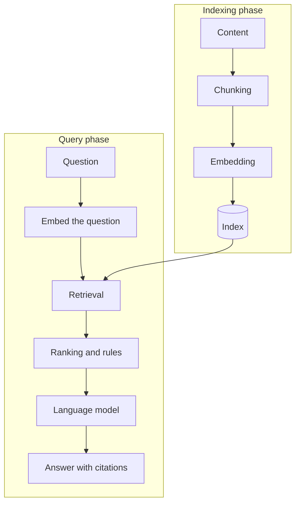

<!--
SECTION TEMPLATE: RAG concepts overview (concept page)
Purpose: Define retrieval-augmented generation (RAG) and the core concepts behind it,
once, in plain language, so that every other page in your documentation can link here
instead of re-explaining. Model this page on the way REST API and MCP documentation
define the technology, link to the official specification, and then move to details.
Audience: Anyone who is new to RAG: developers, technical writers, support staff, and
product managers.
Internal or external: Both. Replace the bracketed product details in "How [product]
applies these concepts" with your own.
Before you write:
- Fill in the final section from your real system. Don't describe features you don't
  have.
- Keep definitions to one or two sentences. Put depth on the in-depth page.
Rules:
- Follow the writing style in ../style.md.
- Define each term the first time it appears, and use the same word every time.
- Link to the canonical source for RAG and for any standard you rely on.
Delete this comment before you publish.
-->

# About retrieval-augmented generation

This page defines retrieval-augmented generation (RAG) and the concepts you need to
use, build, or document it. Read it before the other pages in this section.

## Who this page is for

This page is for anyone who is new to RAG, including developers who are about to
build a RAG application, and writers who document one. It assumes no knowledge of
machine learning. It assumes you know what a search box does.

## What is RAG?

*Retrieval-augmented generation* (RAG) is a technique for answering questions in two
stages. First, a retrieval stage finds passages in a source you control that are
relevant to a question. Then a generation stage gives those passages to a language
model, which writes an answer from them.

RAG lets a model answer from information it wasn't trained on, such as your private,
recent, or product-specific content, and lets the answer point back to its sources.

The technique was introduced in
[Retrieval-Augmented Generation for Knowledge-Intensive NLP Tasks](https://arxiv.org/abs/2005.11401).
[Product] applies the same idea to [your content].

## How RAG works

A RAG system has two phases. In the indexing phase, you prepare your content so that
it can be searched. In the query phase, the system uses that preparation to answer
each question.

The following diagram shows both phases:

## Core concepts

The following table summarizes each core concept and links to the full explanation:

| Concept | Phase | Definition | Learn more |
|---|---|---|---|
| Chunking | Indexing | Splitting content into passages that can be retrieved on their own. | [Chunking](04-concepts-in-depth.md#chunking) |
| Embedding | Indexing and query | Converting text into a vector that represents its meaning. | [Embeddings and vectors](04-concepts-in-depth.md#embeddings-and-vectors) |
| Vector | Indexing and query | A list of numbers. Texts with similar meanings have vectors that are close together. | [Embeddings and vectors](04-concepts-in-depth.md#embeddings-and-vectors) |
| Indexing | Indexing | Storing vectors and text so that the closest matches can be found quickly. | [Indexing](04-concepts-in-depth.md#indexing) |
| Retrieval | Query | Finding the chunks most likely to answer a question. | [Retrieval](04-concepts-in-depth.md#retrieval) |
| Ranking | Query | Ordering retrieved chunks from most to least relevant. | [Ranking](04-concepts-in-depth.md#ranking) |
| Relevance | Query | How well a chunk helps answer a question. | [Relevance](04-concepts-in-depth.md#relevance) |
| Rules | Query | Conditions that filter, boost, or exclude results regardless of similarity. | [Rules](04-concepts-in-depth.md#rules) |
| Grounding | Query | Answering only from retrieved content, and citing it. | [Grounding and citations](04-concepts-in-depth.md#grounding-and-citations) |
| Context window | Query | The amount of text a model can read at once. | [Context window](04-concepts-in-depth.md#context-window) |

## Vocabulary

Use the following terms consistently in your documentation:

| Term | Meaning | Don't use |
|---|---|---|
| Chunk | A retrievable section of a document. | Snippet, piece, segment (unless you define the difference) |
| Embedding | The process of converting text into a vector, or the resulting vector. Say which you mean. | Encoding, fingerprint |
| Vector | A list of numbers that represents meaning. | Array of floats, unless you're writing for developers |
| Index | The store that holds vectors and chunks. | Database, unless it is one |
| Query | The text a user submits. | Prompt, unless you mean the instruction sent to the model |
| Prompt | The full text sent to the model, including instructions and chunks. | Query |

## How [product] applies these concepts

The following table shows how [product] implements each concept. Document your own
choices here, and link to the pages that explain how to change them:

| Concept | What [product] does | Can you change it? |
|---|---|---|
| Chunking | [For example "Splits at headings, up to 1,000 characters"] | [Yes: link, or No] |
| Embedding | [Model name, and the number of dimensions] | [Yes: link, or No] |
| Indexing | [For example "Refreshes every 24 hours"] | [Yes: link, or No] |
| Retrieval | [For example "Keyword and vector search combined"] | [Yes: link, or No] |
| Ranking | [For example "Combined score, then reranked"] | [Yes: link, or No] |
| Rules | [For example "Filter by product version"] | [Yes: link, or No] |
| Grounding | [For example "Answers cite sources and say when nothing matches"] | [Yes: link, or No] |

## Next steps

To continue, use one of the following pages:

- To go deeper on each concept, see [Concepts in depth](04-concepts-in-depth.md).
- To build something, see the [quick start](02-quickstart.md) or the
  [tutorial](01-tutorial.md).
- To document your own system, see [Overview](05-overview.md).
