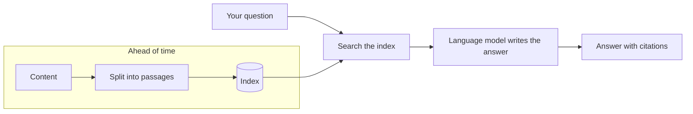

<!--
SECTION TEMPLATE: Overview (concept page)
Purpose: Explain what the system is, what it's for, and how it works at a high level.
This is the page most readers see first, and the page AI agents quote most often.
Audience: Everyone. Keep the first screen readable by someone who has never heard of
RAG.
Internal or external:
- External: describe the system by what it does for the reader. Don't name internal
  services, hosts, or team channels.
- Internal: add an "Owners and support" section with the owning team, the on-call
  channel, and links to runbooks and dashboards.
Before you write, ask the builders:
- In one sentence, what does it answer, and for whom?
- What are the three most common questions it gets?
- What does a model say about those questions without this system's content?
- What should people use instead when it can't help?
Rules:
- Follow the writing style in ../style.md.
- Keep the summary to two sentences.
- Keep "How it works" conceptual. Details belong in 07-how-answers-are-generated.md.
Delete this comment before you publish.
-->

# About [system name]

[System name] answers questions about [topic] using [content, for example "the
product guides and release notes for [product]"]. It's for [audience], and it's best
at [the kind of question it handles well].

## Who this page is for

This page is for anyone who uses, manages, or evaluates [system name], including
[audiences, for example "support agents, administrators, and developers"]. It assumes
no knowledge of RAG or machine learning.

## What is RAG?

[System name] uses *retrieval-augmented generation* (RAG). RAG answers a question in
two stages: it first retrieves passages from content you control, and then gives them
to a language model, which writes an answer from them. The technique was introduced in
[Retrieval-Augmented Generation for Knowledge-Intensive NLP Tasks](https://arxiv.org/abs/2005.11401).

RAG relies on a few core ideas: chunking, embeddings and vectors, indexing,
retrieval, ranking, relevance, and rules. For a definition of each, see
[About retrieval-augmented generation](03-concepts-overview.md).

## Prerequisites

Before you use [system name], make sure you have the following:

- [Access, for example "An account with the Reader role"]
- [What to read first, for example "The quick start"]
- [Anything else the reader needs]

## What you can ask

[System name] handles questions like the following:

- [Example question 1]
- [Example question 2]
- [Example question 3]

[System name] isn't designed for [what it doesn't do, for example "questions about
your own account"]. For those, [what to do instead]. For more information, see
[Limitations](10-limitations.md).

## Why [system name] uses your content

A language model on its own answers from its training data. It doesn't know about
[your product, your policies, or recent changes], so its answers can be generic,
outdated, or wrong. [System name] searches [content] first and gives the model only
the passages that are relevant to your question, so answers reflect the current
[content] and link to it.

The following table compares the same question answered with and without
[system name]'s content:

| | Without [system name]'s content | With [system name]'s content |
|---|---|---|
| Question | [A real, common question] | [Same question] |
| Answer | [What a model says on its own, abbreviated] | [What the system says, abbreviated] |
| Sources | None | [Linked page titles] |

<!-- Use a real question. If the answer without content happens to be right, pick a
question about something recent or specific to your organization. -->

## How it works

[System name] works in three stages: it prepares the content ahead of time, finds the
relevant passages when you ask a question, and writes an answer from those passages.

The following diagram shows the three stages:

The stages work as follows:

1. **Ingest:** [System name] splits [content] into short passages and stores them in
   a searchable index. This happens [when, for example "within one hour of a page
   being published"].
2. **Retrieve:** When you ask a question, [system name] searches the index and
   selects the [number] most relevant passages.
3. **Generate:** A language model writes an answer using only those passages, and
   cites each one it used.

If no passage is a good match, [system name] [what it does, for example "says it
couldn't find an answer and suggests contacting support"] instead of guessing.

For details about each stage, see
[How answers are generated](07-how-answers-are-generated.md).

## How to check an answer

Every answer lists the [pages, documents, or passages] it was written from. Open them
before you [high-stakes action, for example "change tax or payment settings"].

## Key terms

The following terms appear throughout this documentation:

| Term | Meaning |
|---|---|
| Passage | A short section of a source document that [system name] can retrieve. Also called a chunk. |
| Index | The searchable store of passages that [system name] retrieves from. |
| Citation | A link from a statement in an answer to the passage it came from. |
| Source | A site, repository, folder, or file that [system name] indexes. |

## Next steps

To continue, see the following pages:

- To ask your first question, see [Get started with [system name]](02-quickstart.md).
- To see what [system name] can answer from, see [Manage content](06-manage-content.md).
- To learn what it can't do, see [Limitations](10-limitations.md).
