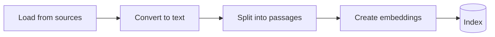
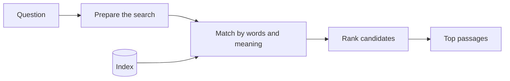

<!--
SECTION TEMPLATE: How answers are generated (concept page)
Purpose: Explain each stage between a question and an answer in enough detail that a
reader can predict the system's behavior and understand its failures.
Audience: Curious users, evaluators, admins, and developers.
Internal or external:
- External: describe behavior and choices, not vendors or internal parameters,
  unless your readers configure them. Name a model or vendor only if your
  organization has decided to disclose it.
- Internal: name every component, model, and version, and link to the code or
  configuration that sets each value.
Before you write, ask the builders:
- How is content split into passages? About how long is a passage?
- What happens to a question before the search: is it rewritten, split, or filtered?
- Does the search match exact words, meaning, or both? Is there a ranking step?
- How many passages reach the model? What instructions does the model get?
- What happens when no passage is a good match?
Rules:
- Follow the writing style in ../style.md.
- Use the stage names Ingest, Retrieve, and Generate on every page.
- Every behavior you describe here must be testable. Test it.
Delete this comment before you publish.
-->

# How answers are generated

This page explains what happens between the moment [system name] receives a question
and the moment it returns an answer. Use it to understand why an answer looks the way
it does, and why [system name] sometimes can't answer.

[System name] works in three stages: ingest, retrieve, and generate. Ingest happens
ahead of time. Retrieve and generate happen each time someone asks a question.

## Who this page is for

This page is for evaluators, administrators, and developers who need to understand why [system name] answers the way it does.

## Prerequisites

Before you begin, make sure you have the following:

- A read of [About retrieval-augmented generation](03-concepts-overview.md)
- For the details behind each stage, see [Concepts in depth](04-concepts-in-depth.md)

## Why [system name] retrieves passages

[System name] doesn't give the model all of [content] with every question, for three
reasons:

- **Context limits:** a model can read only a limited amount of text at once, and
  [content] is larger than that limit.
- **Accuracy:** in a long input, a model is more likely to miss the part that
  matters.
- **Cost and speed:** sending less text makes each answer faster and cheaper.

Instead, [system name] finds the few passages most likely to answer the question and
gives the model only those.

## Ingest

During ingest, [system name] turns [content] into a searchable index. The following
diagram shows the ingest stage:



Ingest has the following steps:

1. **Load:** [System name] reads each source listed in [Manage content](06-manage-content.md).
2. **Convert to text:** [Describe how formats are handled, for example "PDFs and Word
   documents are converted to text. Images are described in text by a vision model,
   and those descriptions are labeled as generated."]
3. **Split into passages:** Each document is split into passages of about [size, for
   example "a few paragraphs"]. [Describe the rule, for example "Passages follow
   section headings where possible, so a passage usually covers one topic."]
4. **Create embeddings:** Each passage is converted into an embedding, a list of
   numbers that represents its meaning, so that passages can be found by meaning as
   well as by exact words.
5. **Store:** Passages, embeddings, and a link to each passage's source are stored in
   the index.

## Retrieve

When a question arrives, [system name] searches the index for passages that answer
it. The following diagram shows the retrieve stage:



Retrieval has the following steps:

1. **Prepare the search:** [Describe any rewriting, for example "Follow-up questions
   are rewritten to include the earlier context, so 'what about refunds?' becomes a
   complete question." If nothing happens, say the question is used as written.]
2. **Match:** [System name] finds candidate passages that match [exact words, meaning,
   or both]. [Explain why both matter, for example "Exact matching finds error codes
   and setting names; matching by meaning finds passages that use different words for
   the same idea."]
3. **Rank:** [Describe ranking, for example "Candidates are reordered by how well each
   one answers the question, not only how similar it is."]
4. **Select:** The top [number] passages are passed to the generate stage. [Describe
   any filters, for example "No more than two passages come from the same page."]

## Generate

A language model writes the answer from the question and the selected passages.
[System name] gives the model the following instructions:

- Answer only from the passages provided.
- Cite the passage that supports each statement.
- If the passages don't answer the question, say so.

[Add any other behavior, such as answer length, tone, or language.]

### Citations

Each citation links to [what it points to, for example "the section of the page that
contains the passage"]. [State what happens if the source changed after indexing, for
example "If the page changed after it was last indexed, the citation still opens the
current page, which may differ from the passage that was used."]

### When nothing matches

If none of the passages is a good match, [system name] [behavior, for example
"responds that it couldn't find an answer in [content] and suggests [alternative]"].
The following example shows this response:

```text
[Real example of the no-match response]
```

## Next steps

To continue, see the following pages:

- To change how many passages are retrieved or which sources are searched, see the
  [reference](08-reference.md).
- To learn what [system name] can't do, see [Limitations](10-limitations.md).
- To see how well retrieval works, see [Evaluation](12-evaluation.md).
