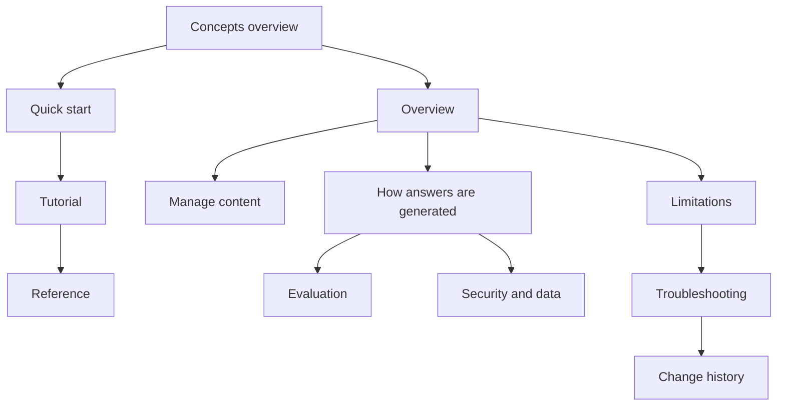

# RAG section templates

These are *section templates*. Each one is a template for one page (or one section
of your documentation site) about a retrieval-augmented generation (RAG) system. They
aren't a single document to fill in from top to bottom. Pick the pages your readers
need, copy each into your documentation site, replace the bracketed placeholders, and
delete the guidance comments.

The templates work for internal documentation, such as an assistant your support team
uses, and for external documentation, such as a feature your customers use or an API
developers call. Each template's guidance comment says what to add or remove for each.

## Who these templates are for

These templates are for technical writers, developers, product managers, and anyone
else who documents a RAG system. You don't need to know how RAG works to start. The
[concepts overview](03-concepts-overview.md) defines every term.

## What is RAG?

*Retrieval-augmented generation* (RAG) answers a question in two stages. First, it
retrieves passages from content you control. Then it gives those passages to a
language model, which writes an answer from them. The technique was introduced in
[Retrieval-Augmented Generation for Knowledge-Intensive NLP Tasks](https://arxiv.org/abs/2005.11401).

Every RAG documentation set should define the core concepts: chunking, embeddings and
vectors, indexing, retrieval, ranking, relevance, and rules. The
[concepts overview](03-concepts-overview.md) and
[concepts in depth](04-concepts-in-depth.md) templates give you pages to adapt.

## Before you start

Before you use these templates, make sure you have the following:

- Access to the people who built the system, or to its design documents
- A working copy of the system that you can test
- A read of [How to use these templates](../how-to-use.md)
- A read of [Writing style for these templates](../style.md)

## Why a RAG system needs its own documentation

Call an API with the same input and you get the same output, so its documentation can
describe inputs and outputs. Ask a RAG system the same question twice and the answer
can change, because it depends on things the reader can't see: what content was
indexed and when, which passages the search found, and how the model used them.
Readers aren't only asking "what does it return?" They're asking "when can I trust
what it returns, and what do I do when I can't?"

For how a RAG system works, read
[How passages become answers](../../write-for-ai/03-how-passages-become-answers.md).

## The templates

The following table lists the templates in three groups: pages that teach, pages that
explain the system, and pages that help people run it. For each template, it shows the
page type, the question it answers, and when to write and update it:

| Template | Page type | Answers | Primary audience | Write it | Update it when |
|---|---|---|---|---|---|
| [Tutorial](01-tutorial.md) | Tutorial | How do I build a working RAG application, step by step? | Developers | When the system works end to end | A step, a dependency, or the output changes |
| [Quick start](02-quickstart.md) | Tutorial | How do I get a first result in minutes? | New users, developers | Once sample data and a first query work | The steps or the output change |
| [Concepts overview](03-concepts-overview.md) | Concept | What is RAG, and what do these terms mean? | Everyone | Once, at the start | Your terms or defaults change |
| [Concepts in depth](04-concepts-in-depth.md) | Concept | What are the options for each concept, and how do I choose? | Developers, writers | After the design is settled | Your choices change |
| [Overview](05-overview.md) | Concept | What is this system, what is it for, and how does it work? | Everyone | Draft in planning, finish at launch | The scope or audience changes |
| [Manage content](06-manage-content.md) | Task | What does it answer from, and how do I change that? | Operators, content owners | While sources are chosen | A source, format, or refresh schedule changes |
| [How answers are generated](07-how-answers-are-generated.md) | Concept | What happens between a question and an answer? | Evaluators, admins, developers | Once the design is settled | Ingest, retrieval, or generation changes |
| [Reference](08-reference.md) | Reference | What are the exact settings, fields, errors, and limits? | Developers, admins | With the first API or settings release | Any setting, field, or limit changes |
| [Security and data](09-security-and-data.md) | Concept | Who can see what, what is stored, and how is manipulation handled? | Admins, security reviewers | Before a security review | Access, storage, or retention changes |
| [Limitations](10-limitations.md) | Concept | What can't it do, and what should I use instead? | End users | Before launch, tested on the live system | Support reports a new failure, or a limit is fixed |
| [Troubleshooting](11-troubleshooting.md) | Troubleshooting | Why did this go wrong, and how do I fix it? | Admins, developers, support | After the first support tickets | A new common problem appears |
| [Evaluation](12-evaluation.md) | Concept | How good is it, and how was that measured? | Evaluators, buyers | At launch | Every evaluation run |
| [Change history](13-change-history.md) | Reference | Why is it answering differently from before? | Operators, support | From launch onward | Every content, retrieval, or model change |

The following diagram shows how a reader moves through the set:

## Start with the minimum set

If you can't write all thirteen pages at once, start with the following five, in this
order:

1. **Concepts overview:** it defines RAG and the terms every other page uses.
2. **Limitations:** it prevents the most support requests.
3. **Overview:** it's the page most readers and AI agents see first.
4. **Manage content:** readers can't judge an answer without knowing its sources.
5. **Quick start:** it turns a reader into a user.

## Write the documentation

Follow these steps to document a RAG system:

1. **Interview the builders with the templates open.** Each template's guidance
   comment lists the questions to ask.
2. **Test every claim yourself.** Ask the system the questions from the limitations
   page and the quick start. If the system behaves differently from the page, one of
   them is wrong.
3. **Copy real output.** Use the system's actual responses in examples, not
   idealized ones.
4. **Publish evaluation results only with their method.** If there are none yet, say
   what's planned.
5. **Give every page an owner and a review date,** and review the content pages on
   the same schedule as the content refresh.

## Example

The [Kestrel documentation assistant example](example-kestrel-docs-assistant.md) shows
the tutorial template filled in for a fictional hosting platform. For admin, end user,
and developer guides, use the [audience guides](../audience-guides/).

## Related pages

The following pages are related to this set:

- [How to use these templates](../how-to-use.md)
- [Documentation best practices for AI systems](../best-practices.md)
- [Writing style for these templates](../style.md)
- [RAG diagrams](../diagrams/rag.md)
