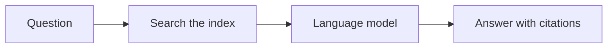

# Writing style for these templates

The templates in this repository follow the
[Google developer documentation style guide](https://developers.google.com/style).
This page summarizes the rules that matter most for AI system documentation, so you
can keep your filled-in pages consistent with the templates. When this page and the
Google guide disagree, follow this page; when this page is silent, follow the Google
guide.

## Voice and tone

Write the way a knowledgeable colleague explains something: direct, friendly, and
precise. Apply the following rules:

- **Address the reader as "you."** Don't use "we," "our," "us," or "let's." Refer to
  your organization or team by name, for example "The Support Content team reviews
  every new source."
- **Use active voice.** Write "The assistant retrieves five passages," not "Five
  passages are retrieved."
- **Use present tense.** Write "The router sends the ticket," not "The router will
  send the ticket."
- **Use contractions** such as "don't" and "can't" in most prose. They read more
  naturally.
- **Don't use "please," "simply," "easy," "just," or "obviously."** What is easy for
  one reader isn't easy for another.
- **Don't use em dashes.** Use a comma, a colon, parentheses, or a new sentence.

## Accessible and global language

Many readers use screen readers, read in a second language, or use a translation
tool. Apply the following rules:

- **Write short, literal sentences.** Avoid idioms, slang, and cultural references.
- **Define abbreviations on first use,** for example "retrieval-augmented generation
  (RAG)."
- **Don't use directional language** such as "above," "below," or "on the right."
  Use "preceding," "following," or a link to the section.
- **Write descriptive link text.** Write "see [Add a content source](#)," not "click
  [here](#)."
- **Write "for example," not "e.g.,"** and "that is," not "i.e."
- **Use inclusive terms,** such as "allowlist" and "denylist."

## Lead-in sentences

Introduce every list, table, procedure, and code sample with a complete sentence.
End the lead-in sentence with a colon when the element follows immediately, or a
period when something comes between them. For example:

> The following table lists the content sources the assistant searches:

A heading isn't a lead-in sentence. Put a sentence between a heading and the list or
table that follows it.

## Page openings

Open every tutorial, quick start, and concept page with the following, in order:

1. **A summary** of one or two sentences that says what the page covers.
2. **Who the page is for,** including the skills the reader needs.
3. **What the reader will build or learn,** before any steps.
4. **Definitions** of the core terms, with a link to the official reference or
   specification for the technology. REST API and MCP documentation does the same.
5. **Prerequisites,** as a list of everything the reader needs before step one.

## Images and diagrams

Every image and diagram needs a text alternative. Apply the following rules:

- **Images:** write alt text that conveys what the image shows and why it's there,
  in one or two sentences. Don't start with "Image of." If an image is decorative,
  use empty alt text (``).
- **Diagrams:** give each Mermaid diagram an `accTitle` and an `accDescr`, and put a
  sentence before it that states what it shows. Make sure the text around a diagram
  conveys the same information, so a reader who can't see it loses nothing.
- **Don't put essential text only in an image,** such as a setting name or a
  threshold.

The following example shows a diagram with a title and a description:

````markdown
The following diagram shows how a question becomes an answer:


````

## Headings

Apply the following rules to headings:

- **Use sentence case,** for example "Add a content source."
- **Start task headings with a bare infinitive,** for example "Add a content source,"
  not "Adding a content source."
- **Use noun phrases for concept and reference headings,** for example "How answers
  are generated" or "Supported file types."
- **Don't skip heading levels,** and don't use more than one level-one heading on a
  page.

## Procedures

Write steps the reader can follow without rereading. Apply the following rules:

- **Number the steps** when order matters. Use bullets when it doesn't.
- **Put one action in each step.** Two short, related actions in the same location
  can share a step.
- **Put the condition or location before the action,** for example "In the
  **Sources** panel, click **Add source**."
- **State the expected result** at the end of the step or the procedure.
- **Use a single-step format** for a procedure with one step: write it as a sentence,
  not a numbered list.

## Formatting

Apply the following formatting rules:

- **Bold** the names of interface elements, such as **Save** or **Account > Activity**.
- Use `code font` for code, commands, file names, field names, parameter values, and
  environment variables.
- Use notes sparingly. Reserve **Caution** and **Warning** for risks of data loss,
  security exposure, or harm.
- Use the serial comma, for example "ingest, retrieve, and generate."
- Write numbers as numerals in technical content, for example "5 passages," and
  include units, for example "4 MB."

## Before you publish

Check your page against the following list:

- [ ] The page opens with a summary of what it covers and who it's for.
- [ ] There is no "we," "our," "us," or "let's."
- [ ] Every list, table, procedure, and code sample has a lead-in sentence.
- [ ] Every image has alt text, and every diagram has a title, a description, and an
      introductory sentence.
- [ ] There is no directional language such as "above" or "below."
- [ ] Every link has descriptive text.
- [ ] Every abbreviation is defined on first use.
- [ ] Every number that describes quality has its method beside it.
- [ ] All template guidance comments and `[bracketed placeholders]` are removed.
