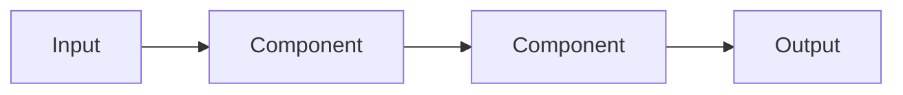

<!--
SECTION TEMPLATE: Technical design document (concept page)
Purpose: Record how an AI system is built and why, for review before the build and
as a reference afterward. Works for RAG, decision-model, and hybrid systems.
Audience: The people who build, review, and maintain the system. Usually internal.
Internal or external:
- Internal: the default. Link to repositories, dashboards, and tickets.
- External: publish only an approved summary, without internal hostnames, credentials,
  or unreleased plans.
Before you write, ask the builders:
- Which options were considered and rejected, and what evidence ruled each one out?
- Who approves the design, and who owns the system after launch?
Rules:
- Follow the writing style in ./style.md.
- Delete sections that don't apply, and say why in one line instead of deleting them
  silently.
- Record rejected options with their evidence, so they aren't proposed again without
  new information.
Agent notes:
- Infer from the repo: the architecture, components, data stores, and configuration.
- Ask a person: the problem, the goals and non-goals, the rejected options and their
  evidence, and who approves the design.
Delete this comment before you publish.
-->

# [System name] technical design

This document describes how [system name] is built, the decisions behind it, and how
its quality is measured.

The following table lists the document's status:

| Field | Value |
|---|---|
| Owner | [Name] |
| Status | [Draft, approved, built, or retired] |
| Last updated | [YYYY-MM-DD] |

## Who this page is for

This document is for the people who build, review, and maintain [system name].

## Prerequisites

Before you review this document, make sure you have the following:

- [Link to the request or problem statement that started this work]
- [Access to the repository and environments, with links]

## Problem

[Describe the problem, who has it, and how it's solved today.]

## Goals and non-goals

The design has the following goals and non-goals:

- **Goals:** [Measurable goals, for example "Answer 80% of how-to questions with an
  answer supported by its citations."]
- **Non-goals:** [What the system deliberately won't do.]

## Architecture

[Describe the architecture in one paragraph.] The following diagram shows the
components and how data flows between them:

The following table lists each component:

| Component | Kind | Responsibility |
|---|---|---|
| [Name] | [Retrieval, decision model, language model, or code] | [Responsibility] |

## Content and data

The system uses content and data as follows:

- **Sources:** [What content the system reads, where it comes from, and how often it
  refreshes.]
- **Preparation:** [How content is split, labeled, and indexed, or how the state is
  assembled.]
- **Sensitive data:** [What is excluded or redacted, and where that's enforced.]

## Prompts, questions, and criteria

[Describe the instructions given to language models and the questions and criteria
given to decision models, and where each is stored and versioned.]

## Thresholds

The following table lists each threshold, its value, and how it was chosen:

| Threshold | Value | Why | How it was measured |
|---|---|---|---|
| [Weak match] | [Value] | [Reason] | [Method] |
| [Confidence to act] | [Value] | [Reason] | [Method] |

## Failure handling

[Describe what happens when each component is wrong, unsure, or unavailable. See the
[hybrid failure modes template](hybrid/05-failure-modes.md).]

## Security

[Describe access control, data retention, and prompt injection mitigations. See the
security templates in the [RAG](rag/09-security-and-data.md) and
[decision model](decision-model/10-security-and-data.md) sets.]

## Evaluation plan

[Describe the test set, the measures in plain language, and when the evaluation
runs.]

## Observability

[Describe what is logged for each request, such as the input, the passages or
criteria used, the result, and the confidence; how long it's kept; and who reviews
it.]

## Alternatives considered

The following table lists the options that were considered and not chosen:

| Option | Why it wasn't chosen | Evidence |
|---|---|---|
| [Option] | [Reason] | [What was measured] |

## Open questions

The following questions are unresolved:

- [Question, owner, and date to resolve it]
