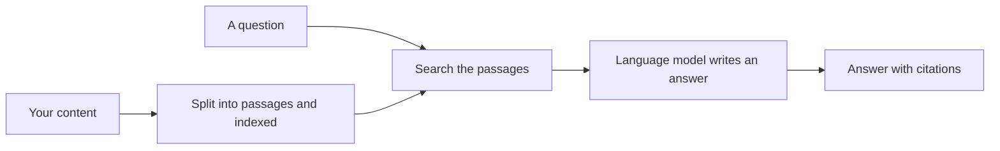
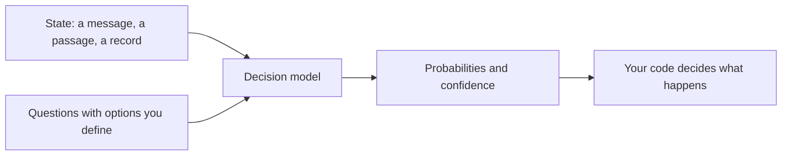
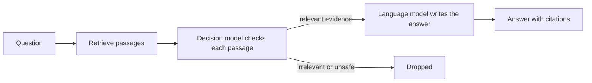

# How AI uses your content

Your content no longer only gets read. It gets split, searched, quoted, and used to
make decisions, often without a person ever opening the page. Knowing how that works
is what lets you write content that holds up when AI uses it.

There are three common ways an AI system uses content today.

## 1. To generate an answer (RAG)

A RAG system (retrieval augmented generation) searches your content for passages
related to a question, hands the best ones to a language model, and the model writes
an answer from them.

**What your words become:** evidence. A passage is quoted, paraphrased, or ignored.

## 2. To make a decision (Jev)

A decision model, such as Jev from
TypeSafe AI, does not write text at all. It receives a piece of content (the *state*)
and typed questions with defined options, and returns a probability for each option
plus a confidence score. Software then acts on the result: route a ticket, flag a
passage, approve or escalate.

**What your words become:** criteria. The option descriptions and definitions you
write are what the model judges against.

## 3. Both together (hybrid)

Many real systems combine the two. A decision model classifies the question, or
checks which retrieved passages are relevant, and a language model writes the answer
from what passed.

**What your words become:** both evidence and criteria.

## Why this matters for writers

The following table shows what your content needs to do for each way an AI system uses it:

| If your content is used as | It needs to |
|---|---|
| Evidence (RAG) | Make sense as a short passage, out of context, with the answer stated plainly |
| Criteria (decision models) | Define each option precisely, so options do not overlap |
| Both (hybrid) | Do both, and be consistent, because one part judges what the other part says |

The rest of this section goes one level deeper on each.

## Next

[How content becomes passages](02-how-content-becomes-passages.md)
