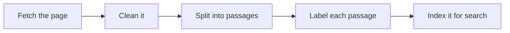

# How content becomes passages

Before a RAG system can answer anything, it prepares your content. Every step changes
what an AI will later see, and most of them are invisible to the person who wrote the
page.

## The steps

### 1. Fetch

A crawler downloads your pages, or reads files from a repository or upload. Pages
that need a login, load their text only with JavaScript, or are blocked in
`robots.txt` may never be fetched. Whatever is not fetched does not exist to the AI.

### 2. Clean

Navigation, footers, cookie banners, and styling are stripped so only the content is
left. Text inside images, tabs that never opened, and interactive widgets are often
lost here.

### 3. Split into passages

The page is cut into passages, usually a few paragraphs each. Systems commonly split
at headings and keep some overlap between neighbors so a sentence is not cut in half.
A long section becomes several passages; a short page may become one.

### 4. Label

Each passage keeps some context: the page title, the heading it sat under, the URL,
sometimes a version or date. That label is often all the context a passage carries
into an answer.

### 5. Index

Passages are stored so they can be searched two ways: by exact words (good for error
codes, settings, and product names) and by meaning (good for questions phrased
differently from your docs).

## What a passage looks like to the AI

Your page:

> **Configure retries**
>
> Retries are off by default. To turn them on, set `retry_limit` in your project
> settings. ... (four more paragraphs) ... Note that this does not apply to webhooks.

What the AI may receive, as one passage:

> *Page: Project settings. Section: Configure retries.* ... Note that this does not
> apply to webhooks.

The passage arrived without the first paragraph. If that last sentence said "this
does not apply to them", the AI would not know what "them" means.

## What this means for writers

The following table shows what can go wrong at each step, and what to write to prevent it:

| Step | What goes wrong | What to write |
|---|---|---|
| Fetch | Content behind JavaScript or login is never seen | Publish important content as plain HTML or Markdown |
| Clean | Text in images and tabs disappears | Put essential information in body text |
| Split | A passage loses the context above it | Make every section stand on its own |
| Label | A vague heading gives the passage no meaning | Use headings that say what the section does |
| Index | Users search for words your page never uses | Include error messages, old names, and synonyms |

The practical version of this table is
[Writing docs AI can use](06-writing-docs-ai-can-use.md), and the site-level version
is the [site agent readiness checklist](../checklists/site-agent-readiness.md).

## Next

[How passages become answers](03-how-passages-become-answers.md)
