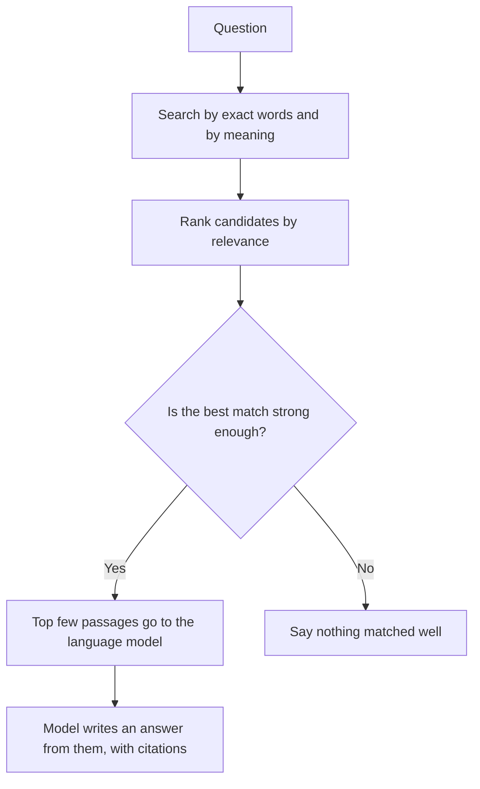

# How passages become answers

Once your content is indexed as passages, here is what happens when someone asks a
question.

## The steps

### 1. Search

The question is matched against every passage, both by the words it contains and by
what it means. This produces dozens of candidates.

### 2. Rank

Candidates are ordered by how well they match. Many systems run a second, more careful
comparison on the top candidates, because the first search is fast but rough.

### 3. Select

Only a handful of passages, often three to ten, are passed on. A language model can
only read so much at once (its *context window*), and more text is not better if it is
off topic. Your page competes with every other page for these few seats.

### 4. Generate

The model writes an answer, usually instructed to use only the passages it was given
and to cite them. The answer can quote a passage, combine several, or miss the one
sentence that mattered.

### 5. Cite, or decline

Good systems link each claim to its passage. When nothing matched well, they say so
instead of guessing. Whether a system does this is a design choice, and it is worth
documenting (see the [RAG limitations template](../templates/rag/10-limitations.md)).

## Where answers go wrong, and what writing can fix

The following table lists common problems with answers, their usual causes, and what a writer can do:

| What happened | Common cause | What a writer can do |
|---|---|---|
| The answer missed the right page | The page never uses the words people ask with | Add the terms, error messages, and synonyms readers use |
| The answer used an outdated page | Old and current versions look alike | Label versions clearly; retire or mark archived pages |
| The answer is right but incomplete | The key condition was in a different passage | Keep conditions inside the step they apply to |
| The answer contradicts itself | Two pages disagree | Fix the disagreement; pick one page as the source of truth |
| The answer made something up | No passage covered it, and the system guessed | Document the gap, or state what is not supported |

You can only fix these if you can see them. That is what
[connecting content to answers](05-connecting-content-to-answers.md) covers.

## Next

[How decision models use context](04-how-decision-models-use-context.md)
