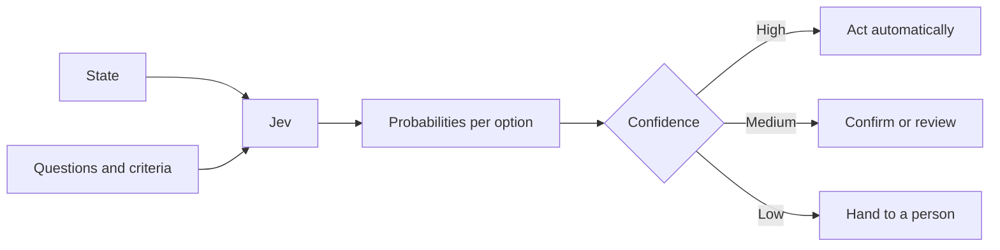

# How decision models use context

Not every AI system writes text. A *decision model* reads content and makes a
judgment: which category, how severe, yes or no. Jev, from TypeSafe AI, is one
example, and this page uses it to explain how such models use your words.

## Generative and decision models, side by side

The following table compares the two kinds of model:

| | Generative model (as in RAG) | Decision model (such as Jev) |
|---|---|---|
| Output | Text for a person to read | Probabilities and a confidence score for software to act on |
| Your content's role | Evidence to quote | The state to judge, and the criteria to judge it against |
| How it fails | A fluent answer that is wrong | A choice with low confidence, which code can catch |
| Who reads the result | A person | Code, which then routes, flags, or acts |

## The two inputs: state and questions

Jev takes a **state**, the content to evaluate, and one or more **questions** about
it.

- The **state** can be a string, a JSON object, or a list of strings: a support
  message, a retrieved passage, a record from your application.
- Each **question** has instructions and a set of options, each option with a
  written description (its *criteria*). There are three types:

| Type | Asks | Example |
|---|---|---|
| Noul | Yes or no | "Does this passage answer the question?" |
| Choice | Which one of these options | "Which product area is this ticket about?" |
| Score | Where on an ordered scale | "How urgent is this, from routine to critical?" |

All questions about one state are answered independently and at the same time.

## What comes back

For each question, Jev returns a probability distribution: for a Noul, the probability
that the answer is yes; for a Choice or Score, a probability for every option. For
Choice and Score, the API adds the result and a **confidence** value from 0 to 1,
which is high when probability is concentrated on one option and low when it is
spread out. Use
confidence to decide what software does next: act automatically, ask for
confirmation, or hand off to a person.

## Where writing comes in

In a decision system, the most important writing is the **criteria**: the option
descriptions the model judges against. They behave like a style guide's definitions,
except a machine applies them thousands of times a day.

| Weak criteria | Strong criteria |
|---|---|
| `billing`: "Billing" | `billing`: "Charges, refunds, invoices, or payment methods for the customer's own account" |
| `bug`: "Something is broken" | `bug`: "The product behaves differently from its documentation, with steps the customer can describe" |
| Options that overlap ("account" and "login") | Options that divide the space cleanly, plus an explicit "other" |

Low confidence often means the options overlap or the state does not contain enough to
decide. Both are writing problems before they are model problems.

## What this means for documentation

A decision system needs its questions, criteria, and confidence thresholds
documented, because they are the system's behavior. The
[Jev templates](../templates/jev/) cover them, and the
[hybrid templates](../templates/hybrid/) cover systems that combine decisions with
generated answers.

## Next

[Connecting content to answers](05-connecting-content-to-answers.md)
