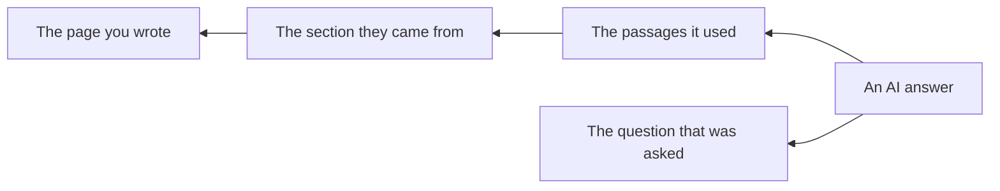
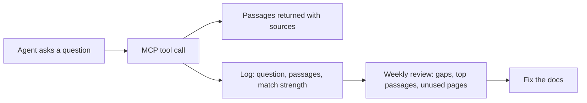

# Connecting content to answers

The previous pages describe a chain: your **page** becomes **passages**, a question
pulls a few of them, and a model turns them into an **answer** or a **decision**.
Content observability is being able to follow that chain backward: from an answer
someone received, to the passage behind it, to the page you wrote.

Page views cannot show this. When an AI answers from your docs, the reader may never
open a page, so page views go quiet while your content does more work than ever.

## The questions observability answers

The following table lists the questions that observability answers, and where to look for each answer:

| Question | Why it matters | What to look at |
|---|---|---|
| Which passages are used most in answers? | These are your real top content now, and they are sections, not pages | Citations per passage and per page |
| What are people asking? | Shows intent in the reader's own words | The questions sent to the assistant, agent, or MCP server |
| Where did nothing match well? | These are content gaps | Questions with weak matches or no answer |
| Which pages are never used? | Candidates to fix, merge, or retire | Pages with zero citations |
| How sure was the system? | Low match strength on a covered topic points to a writing problem | Match or confidence scores per answer |

## MCP observability

When agents reach your content through an MCP server, every tool call is a record of
a real question and the exact passages returned for it. That is richer than search
logs, because it shows what an agent actually handed to a model.

## Do it yourself, starting this week

You do not need special tooling to start.

1. **Collect.** Export the questions and cited pages from whatever you have: your RAG
   system's logs, your MCP server's logs, or your docs search queries. Even 50
   questions are enough to see patterns.
2. **Record.** Paste them into the
   [content usage log template](../templates/content-usage-log.csv), one row per
   question.
3. **Tag.** Mark each row as answered, partly answered, or not answered, based on
   whether the cited passage actually answers the question.
4. **Review weekly.** Sort by "not answered" to find gaps, count pages to find your
   real top pages, and list pages that never appear.
5. **Act.** Write the missing content, fix pages with the
   [page AI readiness checklist](../checklists/page-ai-readiness.md), and record each
   content change in your change history.

## Seeing it per request

The spreadsheet teaches you what matters. Tools can show the same chain for every
request. As one example,
[MCP Studio's analytics](https://docs.appatools.com/mcp-studio/guides/action-predictive-analytics?utm_source=github&utm_medium=oss&utm_campaign=context-for-ai&utm_content=connecting-content)
(disclosure: I build it) show the exact passage behind each answer, with its page and
section, along with content gaps and how confidently each page was matched. Seeing
"this answer came from the third paragraph of the retries section" is what turns the
concepts on this page into a specific edit.

Other tools measure other parts of the chain, such as which AI search engines cite
your pages or which AI crawlers read them. The
[Awesome Context Observability](https://github.com/zthewriter/awesome-context-observability)
list collects them.

## What to report to your team

- Top ten passages and pages used in answers this month, and how that differs from
  page views.
- Top five unanswered questions, with a plan for each.
- Pages with zero use, with a recommendation.

These turn "the docs team writes pages" into "the docs team closed five gaps that AI
answers were hitting", which is the conversation you want with leadership.

## Next

[Writing docs AI can use](06-writing-docs-ai-can-use.md)
