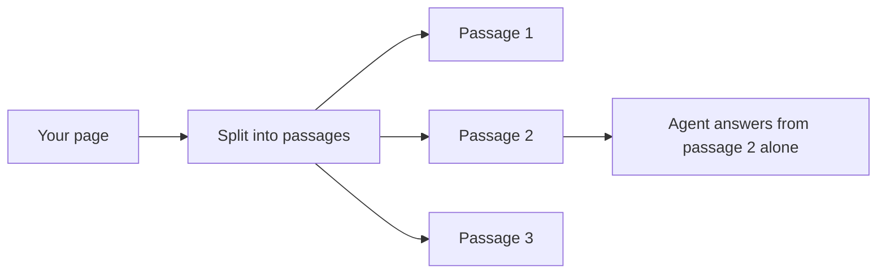

# Writing docs AI agents can use

AI agents now read your docs before many of your human readers do. They do not read
pages: they get passages, a few paragraphs cut out of a page, and they answer from
those. Good docs for agents are mostly good docs for people, written so that any
passage still makes sense on its own.

Run the [page AI readiness checklist](../checklists/page-ai-readiness.md) to score a page
against everything below.

## How an agent sees your page

The agent may get passage 2 without the heading above it, the introduction, or the
prerequisite on the previous screen. Write for that.

## The practices

### 1. Make every section stand on its own

Repeat the subject instead of relying on "it" or "this" from three paragraphs back.

| Depends on context | Stands alone |
|---|---|
| "Set it to 30 to enable this." | "Set `retry_limit` to 30 to enable automatic retries." |
| "As mentioned above, you need a token." | "Webhook requests need an API token in the `Authorization` header." |

### 2. Use descriptive headings

"Configuration" matches every question about anything. "Configure automatic retries"
matches the question it answers. Headings are often kept with the passage, so they
carry meaning into it.

### 3. Use the words people search with

Include the error message exactly as it appears, the old name of a renamed feature,
and the term your users actually say. An agent searching for "SSO" will not find a
page that only says "federated identity".

### 4. Put the answer first

Lead each section with the answer, then the explanation. A passage that ends before
the answer arrives is useless to an agent.

### 5. Keep steps and their conditions together

A warning that applies to step 4 belongs in step 4, not in a callout at the top of
the page.

### 6. Write code that works when copied alone

Include imports and placeholders in every snippet, label the language, and say which
version it is for.

### 7. Label versions

State the version a page applies to. Agents mix versions constantly, and an archived
page that does not say it is archived will be quoted as current.

### 8. Say what is not supported

"Exports to CSV only; Excel is not supported" prevents an agent from inventing an
Excel export. Silence invites a guess.

### 9. Give text equivalents for visuals

Screenshots and diagrams are invisible to most agents. Describe what they show in the
text around them.

### 10. Publish a machine-readable index

An [`llms.txt`](https://llmstxt.org/) file at your site root lists your important
pages for AI tools. Many docs platforms generate one for you.

## Further reading

- [page AI readiness checklist](../checklists/page-ai-readiness.md)
- [Connecting content to answers](05-connecting-content-to-answers.md)
